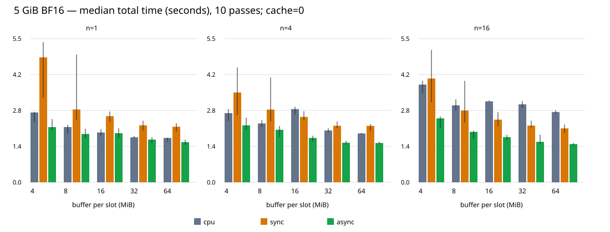

# InWiMe — benchmark V2

Data: 5 novembre 2026.

**Stato: sweep completo**.

Sono disponibili 620 passate misurate. I risultati precedenti in `results/COMPARISON.md` sono mantenuti invariati.

## Metodologia

- Stesso file BF16 da 5.368.709.120 byte per tutte le configurazioni; nessuna quantizzazione, checkpoint o nuova copia del dataset. `k=4096`, `n=1,4,16`; buffer per slot da 4/8/16/32/64 MiB. `m=buffer_bytes/(2*k)` e numero blocchi `5 GiB/buffer_bytes`: la sequenza dei pesi e il volume restano identici.
- CPU OpenMP/SIMD a 8 thread; cuBLAS BF16 con accumulo/output FP32; due buffer host pinned, due stream non bloccanti, nessuna Unified Memory. `n` è il numero di vettori elaborati insieme; `n=1` rappresenta una singola operazione tipo decode, non una generazione autoregressiva completa.
- Disegno a due fasi: 45 combinazioni n×buffer×modalità e 5 baseline I/O, tutte senza cache; 12 combinazioni aggiuntive n×cache×modalità GPU a buffer 8 MiB, con cache da 64/256 MiB. Non è un prodotto cartesiano completo buffer×cache. Ordine configurazioni mescolato con seed 20261105; 10 passate consecutive per configurazione, ciascuna validata.
- Ogni modalità gira in un processo distinto. Inizializzazione e warm-up sono fuori dal timer della passata; include letture, copie, GEMM, ritorno completo FP32, raccolta campioni e attese. Validazione FP64 fuori dal timer. H2D e compute sono intervalli fra eventi CUDA, non necessariamente durate pure del motore: contesa e scheduling possono allargarli.
- Mediana, minimo, massimo, IQR (Q3−Q1, quantili inclusivi) e deviazione standard campionaria: `results/v2/summary.csv` contiene questi valori per ogni tempo di fase e totale. I minimi non sono selezionati come risultati rappresentativi.
- `O_DIRECT`: page cache Linux esclusa, cache Windows/VHD/controller non controllate. Sono misure ripetute dopo warm-up, non letture fisicamente cold. Non sono state svuotate cache globali.

## Confronto n=1,4,16 (buffer 8 MiB, cache disabilitata)


| n | Modalità | Totale med. ms | Min | Max | IQR | σ | Read med. | H2D med. | Compute med. |
| --- | --- | --- | --- | --- | --- | --- | --- | --- | --- |
| 1 | cpu | 2128.99 | 1879.91 | 2212.70 | 213.98 | 130.16 | 1981.41 | 0.00 | 142.61 |
| 1 | sync | 2808.27 | 2393.19 | 4927.52 | 617.45 | 915.56 | 1821.38 | 686.91 | 178.82 |
| 1 | async | 1863.60 | 1699.16 | 2063.89 | 252.28 | 140.82 | 1800.20 | 491.47 | 123.92 |
| 4 | cpu | 2269.36 | 2133.97 | 2398.51 | 153.77 | 93.60 | 1999.47 | 0.00 | 268.65 |
| 4 | sync | 2804.78 | 2345.85 | 4042.50 | 352.46 | 496.24 | 1728.01 | 757.97 | 212.62 |
| 4 | async | 2027.08 | 1755.19 | 2171.72 | 208.45 | 147.02 | 1949.33 | 503.14 | 115.24 |
| 16 | cpu | 2968.37 | 2773.29 | 3197.80 | 234.09 | 151.80 | 2060.87 | 0.00 | 910.00 |
| 16 | sync | 2768.70 | 2297.91 | 3914.73 | 620.51 | 568.11 | 1821.59 | 693.46 | 174.48 |
| 16 | async | 1945.13 | 1681.23 | 1991.06 | 52.09 | 106.19 | 1871.65 | 447.31 | 102.42 |

## Sweep buffer

Tempi complessivi mediani in ms, con minimo–massimo fra parentesi. Cache=0.


| n | Buffer/slot MiB | CPU | GPU sync | GPU async |
| --- | --- | --- | --- | --- |
| 1 | 4 | 2693.8 (2312.5–2717.8) | 4817.3 (3254.8–5405.9) | 2128.0 (2008.4–2439.2) |
| 1 | 8 | 2129.0 (1879.9–2212.7) | 2808.3 (2393.2–4927.5) | 1863.6 (1699.2–2063.9) |
| 1 | 16 | 1921.4 (1799.4–2049.6) | 2550.4 (2327.8–2728.4) | 1894.8 (1712.3–2084.8) |
| 1 | 32 | 1734.7 (1697.6–1791.3) | 2199.1 (1985.2–2374.0) | 1646.6 (1520.8–1739.7) |
| 1 | 64 | 1710.8 (1567.5–1721.3) | 2143.1 (1955.0–2280.3) | 1548.5 (1445.3–1644.3) |
| 4 | 4 | 2667.7 (2357.6–2822.6) | 3464.3 (2598.4–4429.4) | 2197.0 (2022.3–2494.3) |
| 4 | 8 | 2269.4 (2134.0–2398.5) | 2804.8 (2345.9–4042.5) | 2027.1 (1755.2–2171.7) |
| 4 | 16 | 2824.6 (2615.2–2913.1) | 2521.5 (2385.0–2739.5) | 1711.2 (1581.2–1795.0) |
| 4 | 32 | 1997.7 (1929.5–2082.3) | 2181.1 (2082.9–2348.9) | 1526.0 (1454.5–1596.3) |
| 4 | 64 | 1884.4 (1853.2–1905.8) | 2178.3 (1968.8–2245.6) | 1515.2 (1465.9–1563.5) |
| 16 | 4 | 3768.4 (3410.8–3912.4) | 4002.7 (3086.4–5105.2) | 2466.5 (2093.3–2540.3) |
| 16 | 8 | 2968.4 (2773.3–3197.8) | 2768.7 (2297.9–3914.7) | 1945.1 (1681.2–1991.1) |
| 16 | 16 | 3122.6 (3105.2–3154.5) | 2416.6 (2165.9–2708.0) | 1742.6 (1628.8–1832.9) |
| 16 | 32 | 3007.6 (2879.3–3133.4) | 2187.4 (2099.5–2375.2) | 1561.0 (1486.2–1836.2) |
| 16 | 64 | 2710.0 (2651.9–2778.7) | 2079.5 (1903.8–2228.9) | 1474.4 (1408.4–1519.8) |


| Buffer MiB | I/O mediana ms | Min ms | Max ms | IQR ms | GiB/s da mediana letture |
| --- | --- | --- | --- | --- | --- |
| 4 | 2502.72 | 2458.17 | 2952.89 | 39.06 | 1.998 |
| 8 | 1939.72 | 1915.58 | 1977.39 | 19.19 | 2.578 |
| 16 | 1779.97 | 1718.61 | 1885.77 | 69.47 | 2.809 |
| 32 | 1537.05 | 1462.65 | 1695.82 | 97.62 | 3.253 |
| 64 | 1486.19 | 1445.78 | 1565.91 | 48.53 | 3.364 |



## Cache GPU persistente

La cache trattiene un prefisso statico, valido fra passate, dopo riempimento iniziale separato (`cache_setup_ms/bytes` nei log). È una baseline favorevole di riuso, non una LRU né un routing MoE. Con uno scan circolare di 5 GiB, una LRU da 64/256 MiB può avere zero hit. Non si può estrapolare un hit rate MoE da questo test.


| n | Cache MiB | Modalità | Mediana ms | Min | Max | IQR | Letti/passata MiB | Hit/passata | Setup una tantum ms |
| --- | --- | --- | --- | --- | --- | --- | --- | --- | --- |
| 1 | 0 | sync | 2808.27 | 2393.19 | 4927.52 | 617.45 | 5120 | 0 | 0.04 |
| 1 | 0 | async | 1863.60 | 1699.16 | 2063.89 | 252.28 | 5120 | 0 | 0.03 |
| 1 | 64 | sync | 2864.91 | 2292.81 | 3494.33 | 314.11 | 5056 | 8 | 29.30 |
| 1 | 64 | async | 1934.36 | 1709.96 | 2047.18 | 194.44 | 5056 | 8 | 27.59 |
| 1 | 256 | sync | 2487.44 | 2182.54 | 3165.24 | 662.93 | 4864 | 32 | 127.42 |
| 1 | 256 | async | 1869.76 | 1700.19 | 1967.80 | 52.76 | 4864 | 32 | 124.94 |
| 4 | 0 | sync | 2804.78 | 2345.85 | 4042.50 | 352.46 | 5120 | 0 | 0.69 |
| 4 | 0 | async | 2027.08 | 1755.19 | 2171.72 | 208.45 | 5120 | 0 | 0.03 |
| 4 | 64 | sync | 2709.39 | 2337.92 | 3022.88 | 221.58 | 5056 | 8 | 34.67 |
| 4 | 64 | async | 1846.93 | 1655.05 | 2016.04 | 201.52 | 5056 | 8 | 28.39 |
| 4 | 256 | sync | 2529.35 | 2223.74 | 4219.86 | 328.16 | 4864 | 32 | 138.00 |
| 4 | 256 | async | 1733.22 | 1651.38 | 2431.73 | 239.00 | 4864 | 32 | 122.60 |
| 16 | 0 | sync | 2768.70 | 2297.91 | 3914.73 | 620.51 | 5120 | 0 | 0.04 |
| 16 | 0 | async | 1945.13 | 1681.23 | 1991.06 | 52.09 | 5120 | 0 | 0.04 |
| 16 | 64 | sync | 2761.72 | 2336.90 | 3891.10 | 488.02 | 5056 | 8 | 30.14 |
| 16 | 64 | async | 1781.76 | 1641.79 | 2032.76 | 254.57 | 5056 | 8 | 33.55 |
| 16 | 256 | sync | 2817.27 | 2178.13 | 4941.11 | 443.22 | 4864 | 32 | 119.68 |
| 16 | 256 | async | 1874.06 | 1644.85 | 1957.57 | 233.29 | 4864 | 32 | 127.67 |

I soli hit statici rappresentano il 1,25%/5% dei pesi con cache da 64/256 MiB. Confrontare differenze di tempo con IQR e deviazione standard prima di attribuirle alla cache: routing reale e ordine di esecuzione non sono modellati. Anche sugli hit il bracket di eventi H2D può includere un piccolo costo senza copia; il contatore `h2d_bytes` resta zero per gli hit.

## Memoria, swap e telemetria

RSS: HWM del kernel (`getrusage`) a ogni passata. Swap e memoria `/proc/PID/status` campionati ogni 100 ms. Pinned: conteggio applicativo dei byte registrati con CUDA (payload, senza arrotondamento a pagina). Device: allocazioni esplicite A/B/C/cache; non includono contesto e workspace delle librerie. VRAM globale, temperatura, potenza e clock da `nvidia-smi` ogni 200 ms, attribuiti per intervallo temporale della configurazione. I picchi campionati possono perdere transitori; la VRAM globale include display e altri processi.

- Picco RSS massimo: **473.55 MiB**.
- Picco pinned registrato: **129.00 MiB**.
- Massimo device esplicito: **272.25 MiB**.
- Picco swap del processo: **0.00 MiB**.
- Massimo snapshot CUDA globale usato (`total−free`, dopo warm-up/setup cache): **1087.31 MiB**. È uno snapshot per passata, non un picco continuo.
- VRAM globale campionata massima (MiB): **401.00**.
- Temperatura GPU massima (°C): **53.50**.
- Potenza GPU massima (W): **18.28**.
- Range clock SM osservato: **210–2062 MHz**; memoria: **405–6001 MHz**. Include warm-up, attese e validazione.
- Incrementi globali pswpin/pswpout durante le configurazioni: 0/0 pagine; il file BF16 viene letto esplicitamente e lo swap non è usato per lo streaming.

Alimentazione Windows: BatteryStatus=2 (collegato alla rete), piano Bilanciato; nessun clock/power limit/fan modificato. La temperatura non misura quella dell’SSD; non è disponibile una misura NVMe SMART termica attraverso il disco virtuale. Clock dinamici e carico desktop possono introdurre variabilità. `VmPin`/`VmLck` WSL non sono considerati una misura affidabile dei byte pinned CUDA. I valori globali CUDA e NVML possono differire in WSL: non sono sommabili e non certificano un picco VRAM esatto attribuibile al solo processo.

## Profiling CUDA e sovrapposizione


| Trace | Read ms | H2D GPU ms | Kernel GPU ms | H2D ∩ kernel ms | Read ∩ kernel ms | Read ∩ H2D ms |
| --- | --- | --- | --- | --- | --- | --- |
| n1-b4-sync | 2277.208 | 416.524 | 44.842 | 0.000 | non correlabile | non correlabile |
| n1-b4-async | 1975.868 | 417.804 | 44.854 | 0.000 | non correlabile | non correlabile |
| n4-b4-sync | 2276.658 | 416.688 | 61.282 | 0.000 | non correlabile | non correlabile |
| n4-b4-async | 1916.464 | 417.043 | 61.264 | 0.000 | non correlabile | non correlabile |
| n16-b4-sync | 2275.605 | 416.006 | 65.071 | 0.000 | non correlabile | non correlabile |
| n16-b4-async | 2259.331 | 416.739 | 65.023 | 0.000 | non correlabile | non correlabile |
| n1-sync | 1766.915 | 415.107 | 30.608 | 0.000 | non correlabile | non correlabile |
| n1-async | 1851.360 | 416.089 | 30.603 | 0.000 | non correlabile | non correlabile |
| n4-sync | 1635.863 | 414.803 | 35.618 | 0.000 | non correlabile | non correlabile |
| n4-async | 1958.778 | 416.353 | 35.608 | 0.000 | non correlabile | non correlabile |
| n16-sync | 1773.387 | 414.938 | 36.279 | 0.000 | non correlabile | non correlabile |
| n16-async | 1921.567 | 415.968 | 36.253 | 0.000 | non correlabile | non correlabile |
| n1-b16-sync | 1751.783 | 414.162 | 29.776 | 0.000 | non correlabile | non correlabile |
| n1-b16-async | 1653.129 | 416.559 | 29.788 | 0.000 | non correlabile | non correlabile |
| n4-b16-sync | 1681.753 | 414.584 | 34.785 | 0.000 | non correlabile | non correlabile |
| n4-b16-async | 1544.923 | 416.798 | 34.770 | 0.000 | non correlabile | non correlabile |
| n16-b16-sync | 1699.028 | 414.820 | 35.739 | 0.000 | non correlabile | non correlabile |
| n16-b16-async | 1514.514 | 415.954 | 35.693 | 0.000 | non correlabile | non correlabile |
| n1-b32-sync | 1542.050 | 413.916 | 29.208 | 0.000 | non correlabile | non correlabile |
| n1-b32-async | 1502.870 | 415.185 | 29.194 | 0.000 | non correlabile | non correlabile |
| n4-b32-sync | 1541.526 | 414.140 | 31.972 | 0.000 | non correlabile | non correlabile |
| n4-b32-async | 1488.516 | 415.914 | 31.977 | 0.000 | non correlabile | non correlabile |
| n16-b32-sync | 1528.146 | 414.698 | 32.646 | 0.000 | non correlabile | non correlabile |
| n16-b32-async | 1485.204 | 415.887 | 32.641 | 0.000 | non correlabile | non correlabile |
| n1-b64-sync | 1489.928 | 414.372 | 28.911 | 0.000 | non correlabile | non correlabile |
| n1-b64-async | 1423.074 | 415.718 | 28.901 | 0.000 | non correlabile | non correlabile |
| n4-b64-sync | 1446.204 | 414.381 | 33.074 | 0.000 | non correlabile | non correlabile |
| n4-b64-async | 1475.546 | 416.016 | 33.062 | 0.000 | non correlabile | non correlabile |
| n16-b64-sync | 1431.020 | 414.147 | 34.470 | 0.000 | non correlabile | non correlabile |
| n16-b64-async | 1502.604 | 416.897 | 34.507 | 0.000 | non correlabile | non correlabile |


**Limite WSL/CUPTI:** i record host `cuptiGetTimestamp` e le attività GPU hanno un offset incompatibile con la durata della pipeline. Non è stata applicata una traslazione arbitraria: le intersezioni lettura↔GPU restano non misurabili. Le intersezioni H2D↔kernel sono invece calcolabili fra attività GPU nella stessa base temporale. Le timeline SVG in `results/v2/activities/` mostrano solo la parte GPU.

**Risultato del tracing:** nessuna sovrapposizione H2D↔kernel osservata, né in sync né in async, nelle acquisizioni diagnostiche riportate. Il beneficio del tempo totale async è compatibile soprattutto con letture host sovrapposte al lavoro GPU: è un’inferenza dalla struttura della pipeline e dai tempi, non una misura diretta dell’overlap lettura↔GPU. La conclusione vale per i buffer effettivamente profilati, con cache disabilitata.

Intersezioni GPU calcolate sulle unioni degli intervalli nella stessa base temporale CUPTI, evitando doppio conteggio fra stream. Sono acquisizioni diagnostiche separate, non le 10 ripetizioni prestazionali; overhead del tracing non confrontabile con le mediane senza profiler. I contatori in `trace-summary.json` distinguono copie e kernel: cuBLAS può lanciare due kernel per GEMM (osservato a buffer 4 MiB e in alcuni casi 64 MiB); non si assume un kernel per blocco. Gli intervalli vuoti di scheduling nei bracket CUDA non sono conteggiati come tempo di esecuzione kernel nelle attività CUPTI.

Nsight Systems 2023.4.4 ha prodotto API CUDA e range NVTX `pread`/`pipeline`, ma nessuna tabella attività kernel/memcpy nel primo SQLite. Il problema di percorso dell’importer è stato risolto invocando il binario host già installato. È stato quindi aggiunto un target opzionale CUPTI, senza installazioni e senza dipendenze nuove per il target normale. La sola riduzione del wall time non dimostra sovrapposizione H2D–kernel.

## Storage fisico e percorsi disponibili

- Dataset in ext4 su `/dev/sdd`, disco virtuale WSL2. Il registro Windows identifica il VHDX Ubuntu in `C:\Users\franc\AppData\Local\wsl\{62044ba3-1e2c-4b7f-a9f7-e009245169c7}\ext4.vhdx`.
- `Get-Partition` mappa C: sul disco 0; `Get-Disk` identifica il disco 0 come **Samsung SSD 990 EVO 2TB, BusType NVMe, 2.000.398.934.016 byte**. Quindi è il percorso NVMe interno → NTFS/VHDX → ext4 WSL2.
- Nessun disco USB esterno era elencato da Windows al momento dell’audit iniziale. Non è possibile misurare unità USB o velocità negoziata senza collegarla. Nemmeno un confronto Linux nativo/raw NVMe è disponibile da questa sessione WSL. Non sono stati smontati VHDX, aperti dischi raw o duplicati 5 GiB su DrvFS.
- Evidenze: `results/v2/windows-storage.txt`, `windows-power-vhd.txt`, `linux-environment.txt`. Non interpretare queste misure come banda fisica cold del solo NVMe.

## Verifica numerica e limiti

- `tests/smoke.py --gpu`: output completi con riferimento FP64 su casi piccoli, inclusi code/dimensioni non allineate alle tile, un blocco e riuso dei due buffer; rifiuto di dataset corrotti/troncati e CLI invalida.
- `tests/cache.py`: output completi n=1/4/16, sync/async, miss/hit parziali/hit totali, due passate e conteggio esatto di byte, hit e memoria pinned.
- Nei casi grandi, fino a 32 indici deterministici per blocco, riferimento FP64 rigenerato dalla posizione assoluta nel file: errore assoluto massimo registrato **0.0**. I pesi sintetici sono multipli BF16 esatti di 1/16; non coprono l’intera gamma dinamica dei checkpoint reali.
- Lo sweep usa GEMM indipendenti con k=4096 e B residente. Non include routing, tokenizer, attenzione, KV cache, attivazioni concatenate, conversioni safetensors o verifica di logits reali. Una matrice da 5 GiB elaborata a blocchi non dimostra che un intero LLM o MoE sia eseguibile.

## Raccomandazioni per il primo executor MoE

- n=1: candidato misurato con mediana async migliore **64 MiB/slot**, **1548.47 ms** per 5 GiB. Speedup sulla CPU allo stesso buffer: **1.10×**. Usarlo come punto di partenza, non come optimum universale.
- n=4: candidato misurato con mediana async migliore **64 MiB/slot**, **1515.18 ms** per 5 GiB. Speedup sulla CPU allo stesso buffer: **1.24×**. Usarlo come punto di partenza, non come optimum universale.
- n=16: candidato misurato con mediana async migliore **64 MiB/slot**, **1474.37 ms** per 5 GiB. Speedup sulla CPU allo stesso buffer: **1.84×**. Usarlo come punto di partenza, non come optimum universale.
- Partire da un executor BF16 read-only con offset safetensors verificati, due staging buffer limitati e fallback CPU per ogni operatore. Separare planner di letture, kernel e cache di esperti; riservare VRAM a workspace, attivazioni e KV.
- Per decode usare le misure n=1; batching n=4/16 va valutato solo quando esistono richieste/token realmente aggregabili. Non convertire il throughput di questa GEMM in token/s.
- Aggiungere routing top-k deterministico e una traccia di riuso degli esperti prima di scegliere politica/dimensione cache. Misurare hit rate, bytes miss e costo del primo token: il prefisso statico di questo test non risolve lo scan thrashing.
- Validare un piccolo layer MoE contro il riferimento originale, inclusi gate, up/down projection, SwiGLU, pesi di routing e riduzione degli esperti, prima di scaricare o eseguire checkpoint grandi. Preservare BF16/F16 originale.

## Riproducibilità e dati

```bash
make
LD_LIBRARY_PATH="/usr/lib/wsl/lib${LD_LIBRARY_PATH:+:$LD_LIBRARY_PATH}" python3 tests/smoke.py --gpu
LD_LIBRARY_PATH="/usr/lib/wsl/lib${LD_LIBRARY_PATH:+:$LD_LIBRARY_PATH}" python3 tests/cache.py
python3 tools/benchmark_v2.py
python3 tools/summarize_v2.py
python3 tools/report_v2.py
```

`results/v2/sweep/`: CSV di ogni passata, log warm-up/cache, JSON con comando, hash del binario, tempi e picchi; campioni memoria e GPU. `summary.csv/json`: statistiche per configurazione. `buffer-comparison.svg`: grafico esportabile. L’output è riprendibile solo con lo stesso binario e almeno 10 ripetizioni.

Hash SHA256 del rapporto originale `COMPARISON.md`: `f3f455bddc6babbaf662df02efea32c4dfb58746dfc0bd7b4ce31426be0646eb`.

Riferimenti: [CUDA su WSL](https://docs.nvidia.com/cuda/archive/12.4.0/wsl-user-guide/index.html), [CUPTI Toolkit 12.4](https://developer.nvidia.com/cupti-ctk12_4).

---

## Aggiornamento: disco esterno collegato

Data: 5 novembre 2026.

**Stato: completo (60 passate)**.

### Perimetro e dispositivo

L’utente ha scelto il confronto mirato: solo I/O e GPU asincrona n=1, 10 ripetizioni per percorso, buffer 64 MiB/slot, cache GPU disabilitata. La matrice completa CPU/sync/async e n=1/4/16 del precedente V2 resta separata; non si dichiarano misurate quelle combinazioni sul disco esterno.

Windows identifica il disco 2 come **Sabrent SSD, BusType USB, 512.110.190.592 byte**, partizione D: NTFS, circa 152 GiB liberi all’audit. Non è l’unità da 1 TB menzionata nel brief. Il bridge è **Realtek VID 0BDA / PID 9210**, driver **UASPStor**, percorso PnP `USBROOT(0)#USB(15)` / ACPI `SS03`. Questi dati identificano il collegamento, ma non certificano il protocollo interno NVMe/SATA né la velocità negoziata in bit/s.

La query WMI della velocità negoziata restituisce null. La diagnostica nativa USB/lettura Windows con P/Invoke è stata bloccata dall’antivirus (`ScriptContainedMaliciousContent`); non sono state cambiate né aggirate le protezioni. Pertanto non è disponibile una baseline di letture Windows native senza cache, né una misura diretta della velocità del link USB. Lo script diagnostico è separato in `tools/diagnostics/`, non fa parte della suite eseguita.

### Metodologia e risultati

- Stessi 5 GiB BF16 e stesso SHA256 per tutti i percorsi: `fbfd729651af3054f46600bd042c08f71d87f5a915479af9329bd6617a2c8c0b`.
- NVMe interno Samsung 990 EVO 2TB: file originale in ext4/VHDX WSL e copia di controllo su C: via DrvFS. USB: copia su D: via DrvFS. Le copie sono state create esclusivamente in due directory temporanee di proprietà del test, con limite totale 10 GiB; nessun file preesistente sovrascritto.
- Stesso binario C++ del V2, `k=4096`, `m=8192`, 80 blocchi da 64 MiB, `n=1`, 8 thread CPU configurati, due slot/stream nella modalità GPU. Volume logico letto: 5.368.709.120 byte per passata, oltre ai due blocchi di warm-up GPU fuori timer. Nessuna Unified Memory o streaming tramite swap.
- `O_DIRECT` richiesto senza fallback. Esclude la cache dati Linux; le cache Windows/controller non sono state svuotate. Il costo DrvFS/9p è parte del risultato, che non equivale alla banda intrinseca del solo SSD.
- RSS HWM dal kernel; memoria/swap processo campionati ogni 100 ms; VRAM globale, temperatura, clock e potenza GPU ogni 200 ms. Statistiche su 10 ripetizioni: mediana, minimo, massimo, IQR inclusivo e σ campionaria.

| Percorso | Modalità | N | Mediana s | Min s | Max s | IQR s | σ s | GiB/s da mediana | Read ms | H2D ms | GEMM/eventi ms | D2H ms |
| --- | --- | --- | --- | --- | --- | --- | --- | --- | --- | --- | --- | --- |
| internal-ext4 | async | 10 | 1.515 | 1.445 | 1.605 | 0.050 | 0.052 | 3.301 | 1489.05 | 424.14 | 45.64 | 0.59 |
| internal-ext4 | io | 10 | 1.597 | 1.523 | 1.667 | 0.034 | 0.042 | 3.131 | 1596.86 | 0.00 | 0.00 | 0.00 |
| internal-drvfs | async | 10 | 31.495 | 29.886 | 36.327 | 3.112 | 2.253 | 0.159 | 31432.04 | 3202.62 | 653.97 | 2.67 |
| internal-drvfs | io | 10 | 30.516 | 28.496 | 33.368 | 1.672 | 1.386 | 0.164 | 30515.98 | 0.00 | 0.00 | 0.00 |
| external-usb | async | 10 | 51.810 | 50.216 | 53.732 | 1.960 | 1.245 | 0.097 | 51746.07 | 3203.49 | 654.42 | 2.67 |
| external-usb | io | 10 | 54.092 | 52.274 | 58.232 | 1.806 | 1.793 | 0.092 | 54091.77 | 0.00 | 0.00 | 0.00 |

Il campo GEMM/eventi è il bracket di eventi CUDA della GEMM, non la durata pura delle attività kernel. Non viene riutilizzato il profilo kernel del NVMe come se fosse misurato anche su USB. I tempi H2D/D2H ed eventi completi sono nei CSV e nelle statistiche per percorso; scheduling e clock dinamici possono allargare i bracket. Le fasi sovrapposte non si sommano per ricostruire il totale.

### Letture osservate nello stack Windows

I contatori cumulativi `Win32_PerfRawData_PerfDisk_PhysicalDisk.DiskReadBytesPersec` sono acquisiti prima/dopo ogni gruppo. I delta sono byte letti dal disco secondo lo stack Windows: globali al dispositivo, inclusi altri processi e metadati; non sono byte NAND e non escludono cache del controller. Un delta vicino al volume logico supporta l’interpretazione di letture effettive nello stack disco, ma non attribuisce ogni byte esclusivamente al benchmark.

| Gruppo | Disco | Delta letture GiB |
| --- | --- | --- |
| internal-ext4 | 0 C: | 101.389 |
| internal-ext4 | 1 | 0.000 |
| internal-ext4 | 2 D: | 0.000 |
| internal-drvfs | 0 C: | 104.600 |
| internal-drvfs | 1 | 0.000 |
| internal-drvfs | 2 D: | 0.000 |
| external-usb | 0 C: | 5.051 |
| external-usb | 1 | 0.000 |
| external-usb | 2 D: | 49.991 |
| external-usb I/O iniziale, 10 passate | 0 C: | 5.643 |
| external-usb I/O iniziale, 10 passate | 1 | 0.000 |
| external-usb I/O iniziale, 10 passate | 2 D: | 49.991 |

Il gruppo USB principale riusa la baseline I/O già completata: il suo delta successivo riguarda le nuove passate GPU; il gruppo I/O iniziale ha contatori separati. I gruppi di controllo nuovi comprendono I/O e GPU. Sommare i byte nominali in base alle passate effettivamente eseguite, non alle configurazioni riusate dalla funzione di resume.

### Correttezza, memoria e interpretazione

- internal-ext4: errore massimo 0.0, picco RSS 473.32 MiB, pinned registrata 128.06 MiB, VRAM globale campionata 226.0 MiB, snapshot CUDA globale 943.31 MiB, VmSwap osservata 0 byte, temperatura massima 50.0 °C, clock SM 210.0–2040.0 MHz.
- internal-drvfs: errore massimo 0.0, picco RSS 473.24 MiB, pinned registrata 128.06 MiB, VRAM globale campionata 226.0 MiB, snapshot CUDA globale 943.31 MiB, VmSwap osservata 0 byte, temperatura massima 49.0 °C, clock SM 210.0–1500.0 MHz.
- external-usb: errore massimo 0.0, picco RSS 473.02 MiB, pinned registrata 128.06 MiB, VRAM globale campionata 226.0 MiB, snapshot CUDA globale 943.31 MiB, VmSwap osservata 0 byte, temperatura massima 49.1 °C, clock SM 210.0–1500.0 MHz.

I casi grandi verificano campioni deterministici con riferimento FP64; le verifiche complete dei casi piccoli sono quelle della suite V2 e vengono ripetute prima della chiusura dell’esperimento. VRAM NVML e snapshot CUDA sono misure diverse in WSL; non costituiscono un picco esatto per processo. VmSwap riguarda il processo Linux; il pagefile dell’host Windows non è monitorato.

Nel decode misurato, C:/DrvFS impiega **20.80×** il tempo NVMe/ext4 e D:/USB/DrvFS **34.21×**. USB/DrvFS rispetto a C:/DrvFS: **1.64×**.

Per il primo executor MoE usare come riferimento il percorso realmente misurato più rapido, mantenendo il planner di lettura separato dal kernel. Non attribuire l’intera differenza al bus USB: il controllo sullo stesso NVMe interno via DrvFS serve a distinguere il costo del percorso filesystem/virtualizzazione. Prima di acquistare hardware o scegliere l’SSD come sede del modello, misurare il percorso di lettura definitivo. Nessuna modifica a partizioni, VHDX o configurazioni viene effettuata da questo esperimento.

### Dati, pulizia e limiti

Raw CSV/JSON/telemetria e contatori: `results/v2/storage/`. Le statistiche per percorso sono nei rispettivi `summary.csv/json`. Le prove non sono randomizzate fra percorsi né termicamente controllate; sono misure sequenziali nello stesso ambiente, senza garanzie cold. Una mediana async leggermente inferiore alla baseline solo I/O non dimostra che la GPU acceleri il disco: ordine, warm-up e variabilità differiscono. Nessun checkpoint scaricato, nessuna quantizzazione o nuova dipendenza installata.

Le due copie temporanee sono state rimosse; vedi `cleanup.json`.

Hash del rapporto originale `COMPARISON.md`: `f3f455bddc6babbaf662df02efea32c4dfb58746dfc0bd7b4ce31426be0646eb`.

Riferimenti: [controllo della velocità USB](https://learn.microsoft.com/en-us/windows-hardware/drivers/ddi/usbioctl/ns-usbioctl-_usb_node_connection_information_ex_v2_flags), [letture Windows senza buffering](https://learn.microsoft.com/en-us/windows/win32/fileio/file-buffering), [contatori raw PhysicalDisk](https://learn.microsoft.com/en-us/previous-versions/aa394308(v=vs.85)).

