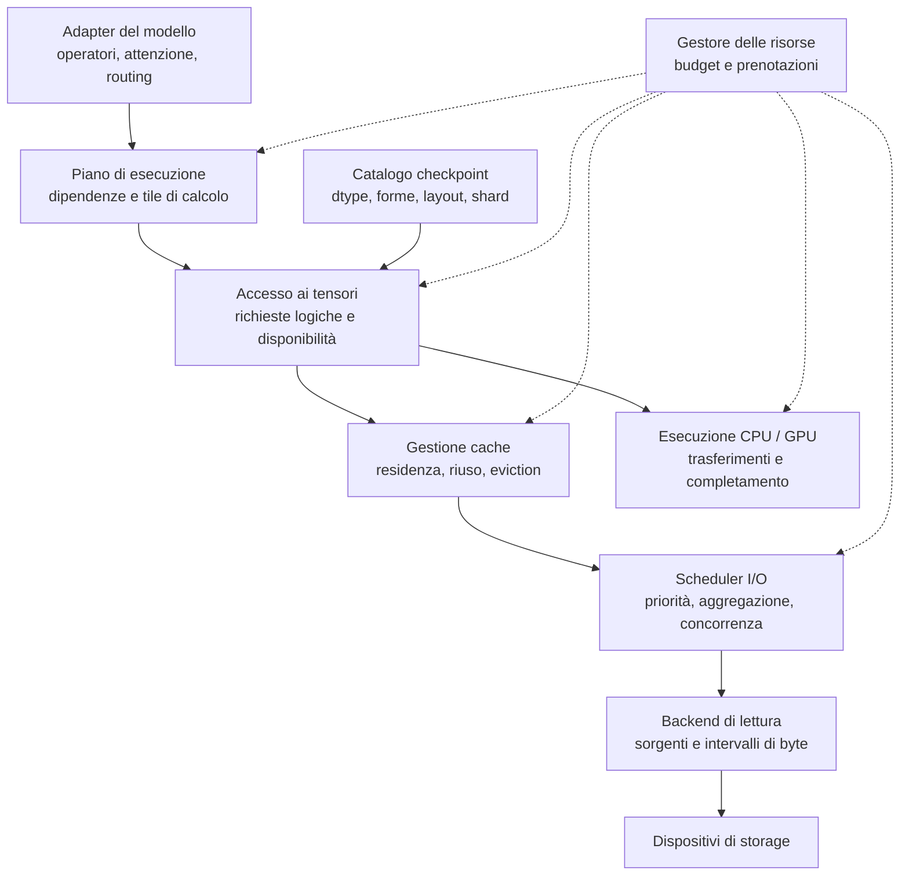
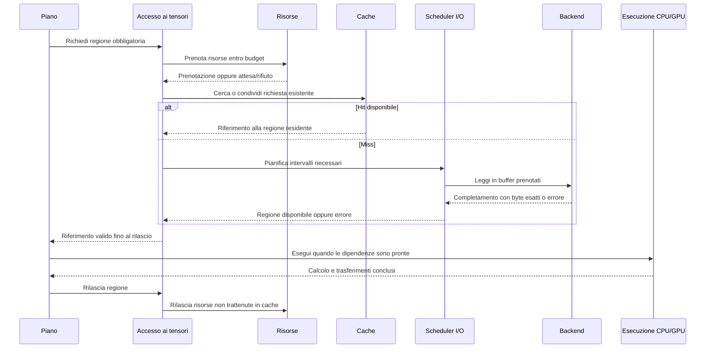
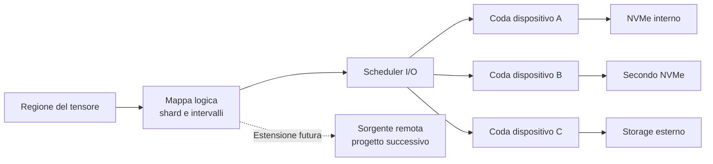

# Briareus — Proposta di architettura modulare

**Data:** 7 novembre 2026.  
**Stato:** proposta da revisionare; nessuna implementazione autorizzata da questo documento.

Briareus è un inference engine out-of-core generale, con accelerazione GPU opzionale e fallback CPU. Deve poter utilizzare NVMe PCIe interni, più dispositivi e storage esterno senza riscrivere il motore. Il contratto di accesso ai checkpoint deve consentire un futuro backend remoto; la distribuzione non viene progettata o implementata in questa fase.

Il Sabrent USB da 512 GB è un dispositivo sperimentale temporaneo. Le misure sul Katana caratterizzano percorsi e condizioni specifici: non fissano dimensioni dei blocchi, numero di buffer, concorrenza o politiche di cache. M1b non è stato avviato in questa sessione.

## 1. Moduli e responsabilità

Le frecce rappresentano collaborazioni logiche, non processi separati né un ordine obbligatorio di chiamate. Il percorso di cache miss attiva lo scheduler I/O; un hit può soddisfare direttamente la richiesta logica.

| Modulo | Responsabilità | Decisioni estranee |
|---|---|---|
| Adapter del modello | Semantica esatta di operatori, routing, attenzione e stato | Percorsi dei file, code disco e politica di cache |
| Piano di esecuzione | Dipendenze, suddivisione del calcolo, vita degli intermedi e scelta CPU/GPU | Comandi di lettura fisica |
| Accesso ai tensori | Tradurre regioni logiche in dati utilizzabili, coordinando cache e letture | Semantica di routing o attenzione |
| Catalogo checkpoint | Descrivere lo snapshot e risolvere tensor/shard/offset | Scelta delle tile in base alla banda del disco |
| Gestione cache | Residenza, riferimenti attivi, ammissione ed eviction | Quali esperti siano matematicamente necessari |
| Scheduler I/O | Ordinamento, aggregazione, priorità e richieste in volo | Precisione dei pesi e semantica degli operatori |
| Backend di lettura | Leggere intervalli esatti da sorgenti identificate | Prefill, decode, layer ed esperti |
| Gestore delle risorse | Prenotare e contabilizzare memoria e capacità in volo | Politiche specifiche di un checkpoint |

Le interfacce interne devono restare piccole. La separazione delle responsabilità non impone un framework di plugin, processi separati o un modulo pubblico per ogni struttura interna.

## 2. Contratto logico dei checkpoint

Il catalogo descrive uno **snapshot immutabile** e contiene:

- Identità del modello e revisione del checkpoint.
- Identificatore stabile del tensore, dtype originale, forma, layout e ordine dei byte.
- Mappatura fra regioni del tensore, shard e intervalli delle sorgenti.
- Metadati necessari a interpretare rappresentazioni native inferiori a BF16, quando supportate esplicitamente.
- Informazioni d'integrità disponibili e modalità con cui sono state verificate.

L'indicizzazione non carica i pesi e non crea un record per ogni possibile tile. Offset, lunghezze e prodotti delle dimensioni devono gestire checkpoint molto grandi con controlli di overflow e limiti. Nessun limite del benchmark sintetico diventa implicitamente un limite del catalogo.

| Operazione concettuale | Contratto |
|---|---|
| Aprire uno snapshot | Identificare una revisione coerente e immutabile |
| Descrivere un tensore | Restituire metadati senza materializzarne i pesi |
| Richiedere una regione | Ottenere un completamento asincrono per i dati necessari |
| Suggerire un prefetch | Esprimere un'opportunità rifiutabile o cancellabile |
| Rilasciare una regione | Terminare l'utilizzo e consentire riuso o eviction |

Una regione può essere contigua o una slice traducibile in più intervalli. Eventuali raccolta, copia e riordinamento sono espliciti e contabilizzati. Non è ammessa la materializzazione implicita dell'intero tensore per soddisfare una piccola slice.

Il piano non riceve percorsi locali, file descriptor o dettagli CUDA per identificare i pesi. La destinazione e la rappresentazione necessarie al calcolo sono dichiarate separatamente dall'identità dei dati.

## 3. Contratto fisico di lettura

Il backend riceve identità della sorgente nello snapshot, offset, lunghezza, destinazione di memoria valida, identificatore della richiesta e vincoli operativi applicabili. Restituisce i byte esatti richiesti oppure un errore esplicito. Una lettura parziale non può essere consegnata come regione completa.

Allineamenti, limiti di trasferimento, accesso diretto o buffered e concorrenza supportata sono capacità dichiarate. Una richiesta logica non allineata può richiedere una lettura fisica più ampia e un buffer intermedio: costo e amplificazione devono essere contabilizzati. Nessun fallback cambia silenziosamente le condizioni di un benchmark.

Il primo backend può leggere normali file locali in sola lettura. NVMe interno, storage esterno ed ext4/VHDX possono condividere l'implementazione con profili differenti. L'interfaccia asincrona può inizialmente essere realizzata anche con letture bloccanti su un pool limitato.

Una sorgente modificata invalida la coerenza dello snapshot. Retry e scelta di una collocazione alternativa sono ammessi soltanto mantenendo la stessa identità dei dati; non si mescolano revisioni o risultati parziali dopo un errore.

## 4. Tre granularità indipendenti

| Granularità | Scopo | Fattori determinanti |
|---|---|---|
| Tile di calcolo | Eseguire un operatore entro memoria e workspace disponibili | Forma, kernel, dtype, batch, RAM/VRAM |
| Intervallo I/O | Leggere i byte necessari con costo limitato | Layout, allineamento, latenza, concorrenza e aggregazione |
| Unità di cache | Conservare regioni riutilizzabili | Pattern di riuso, costo di caricamento e budget |

Una tile può richiedere più letture e una lettura aggregata può servire più tile. La cache può usare una suddivisione diversa da entrambe. L'aggregazione deve limitare anche i byte superflui: ridurre il numero di richieste non giustifica amplificazione illimitata delle letture selettive.

## 5. Concorrenza, completamento e vita dei buffer

Ogni richiesta logica indica regione, priorità, natura obbligatoria o speculativa ed eventuale scadenza operativa. Le richieste possono completarsi fuori ordine; il piano rispetta le dipendenze del calcolo.

Il diagramma mostra il percorso con prenotazione riuscita; in attesa o in errore non si prosegue al calcolo.

- Ogni richiesta ammessa raggiunge esattamente uno stato terminale: completata, fallita o cancellata.
- Una cancellazione non rende riutilizzabile un buffer ancora coinvolto in I/O o trasferimenti.
- Completamento della lettura, disponibilità in GPU e fine del calcolo sono eventi distinti.
- I dati sono accompagnati da un riferimento che mantiene valida la residenza fino al rilascio.
- Richieste concorrenti alla stessa regione possono condividere una lettura; deduplicazione e aggregazione restano entro budget.
- La carenza di risorse produce backpressure o rifiuto esplicito, mai allocazioni illimitate.
- Le richieste obbligatorie devono poter avanzare anche in presenza di prefetch; priorità e fairness devono evitare starvation.

## 6. Denso e MoE, prefill e decode

| Carico | Conseguenza sul piano |
|---|---|
| Denso, prefill | Riutilizzo di regioni dei pesi su più token; tile compatibili con attivazioni e workspace |
| Denso, decode | Possibili scansioni ripetute; nessuna assunzione che una piccola cache elimini il traffico dei pesi |
| MoE, prefill | Dopo il routing, aggregazione dei token destinati agli stessi esperti preservando la semantica |
| MoE, decode | Richiesta degli esperti selezionati; eventuali anticipazioni restano speculative |

Le letture obbligatorie derivano dal calcolo effettivo. Cache e prefetch non possono eliminare esperti richiesti o sostituire il routing. Letture sequenziali, selettive e concorrenti devono attraversare lo stesso contratto.

Gli operatori GPU devono poter elaborare tensori oltre la VRAM, comprese suddivisioni lungo la dimensione di riduzione quando necessarie. Tipo di accumulo, ordine delle riduzioni e tolleranze devono essere dichiarati e confrontati con un riferimento indipendente. Adattare la tile non autorizza cambiamenti arbitrari del risultato.

## 7. Budget configurabili

| Budget | Contenuto |
|---|---|
| RAM del motore | Cache host, staging, attivazioni, output, metadati e workspace |
| Memoria pinned | Sottoinsieme della RAM host, non sommato una seconda volta |
| VRAM | Cache device, staging, attivazioni, stato e workspace |
| I/O in volo | Numero di richieste e byte prenotati, globalmente e per dispositivo |
| Prefetch | Byte speculativi, richieste e distanza massima di anticipazione |
| Esecuzione | Lavori concorrenti CPU/GPU e risorse necessarie al completamento |

I budget includono margini per sistema operativo, librerie e carichi esterni. Le allocazioni controllate dal motore devono rispettare i limiti; RSS, memoria globale, page cache e paging host vengono osservati separatamente. Il gestore non può garantire da solo l'assenza di paging dell'intero host.

Le risorse necessarie al completamento devono essere prenotate prima dell'avvio del lavoro. Ordine di acquisizione, capacità riservata alle richieste obbligatorie e rilascio dei buffer devono impedire deadlock fra cache, staging e output.

Le politiche adattive operano entro i massimali configurati: non li aumentano autonomamente. La memoria pinned non è obbligatoria per ogni lettura; copie aggiuntive fra buffer pageable e pinned devono essere dichiarate e misurate.

## 8. Cache e prefetch separati

La cache decide cosa conservare dopo l'utilizzo; il prefetch cosa anticipare. Entrambi devono poter essere disabilitati e valutati indipendentemente.

La cache richiede identità composta da revisione, tensore/regione e rappresentazione; protezione dei riferimenti attivi; contabilizzazione separata di host e device; politiche sostituibili. Le metriche comprendono byte serviti, miss, caricamenti duplicati, eviction e prefetch inutilizzato.

I checkpoint restano immutabili. Eventuali copie riordinate o trasferite in GPU hanno rappresentazione e costo espliciti. Nessuna quantizzazione implicita. Una previsione di riuso influenza una politica, mai la correttezza dell'operatore.

## 9. Più NVMe e futuro storage remoto

La mappa di collocazione è separata dal modello: regione logica → intervalli delle sorgenti → collocazioni disponibili → risorse di storage.

Inizialmente basta collocare shard differenti su dispositivi differenti. Non servono subito striping automatico, migrazione o replica. Lo scheduler mantiene budget e profili per dispositivo e considera gruppi di risorse condivise: percorsi o dischi virtuali diversi possono dipendere dallo stesso NVMe o bus.

Per il futuro backend remoto si conserva ora soltanto il contratto di sorgente identificata, lettura asincrona ed errore esplicito. Trasporto, autenticazione, replica, scadenze e guasti remoti richiederanno un progetto successivo. Nessun coordinatore distribuito viene introdotto in questa fase.

## 10. Decisioni universali e adattive

| Universali | Adattive all'hardware e al carico |
|---|---|
| Correttezza degli operatori e dtype dichiarati | Scelta CPU/GPU |
| Snapshot coerente e pesi immutabili | Dimensioni delle tile |
| Letture esatte ed errori espliciti | Dimensioni e aggregazione delle letture |
| Vita dei buffer e dipendenze | Numero di buffer, worker e operazioni concorrenti |
| Budget contabilizzati e backpressure | Ripartizione del budget fra staging e cache |
| Fallback CPU e tiling oltre VRAM | Politica di cache e profondità del prefetch |
| Identità logica indipendente dalla collocazione | Scelta fra collocazioni disponibili degli stessi dati |
| Telemetria confrontabile | Profilo prestazionale usato dallo scheduler |

I valori adattivi devono poter essere fissati esplicitamente per riprodurre una prova. Un eventuale autotuning deve avere limiti, provenienza del profilo e autorizzazione: nessuna calibrazione prestazionale nascosta all'avvio.

## 11. Evidenze sperimentali e limiti

Il [rapporto M1a](../results/m1a-native-ext4-20261107T075250Z/REPORT.md) conserva le 60 passate sul Katana e il confronto interno/esterno. I [risultati V2 storage](../BENCHMARK_V2_STORAGE.md) conservano il confronto storico con DrvFS.

Queste evidenze dimostrano il comportamento dei percorsi provati, con dataset sintetico, parametri e carico host documentati. Non dimostrano un optimum universale, pattern di riuso MoE, eseguibilità di un LLM completo o prestazioni dello storage distribuito. Paging Windows, cache host non controllate e ordine delle prove restano limiti del confronto.

**64 MiB, due buffer e il Sabrent non diventano costanti architetturali.** Eventuali ulteriori misure M1b saranno caratterizzazione dei dispositivi e dei pattern di accesso, non approvazione automatica di politiche permanenti.

## 12. Criteri di accettazione dopo la revisione

Una prima verifica del contratto dovrebbe utilizzare un adapter in memoria e uno su file:

1. Stessi byte e risultati attraverso entrambi.
2. Slice, code, shard multipli e tensori oltre RAM/VRAM, senza materializzazione completa.
3. Completamenti fuori ordine, cancellazione, errori e letture parziali.
4. Rispetto dei budget con richieste concorrenti, cache disabilitata e pressione sul prefetch.
5. Due sorgenti collocate su dispositivi diversi senza modificare il piano del modello.
6. Confronti numerici indipendenti per CPU e GPU, distinguendo tolleranza da identità bit per bit.
7. Telemetria separata di byte logici richiesti, byte fisici richiesti ai backend, cache hit, amplificazione I/O, attese e memoria.

Questi sono criteri proposti per lavoro futuro. Nessun test, benchmark o sviluppo del motore è avviato da questa proposta. Implementazione e ulteriori esperimenti attendono la revisione del progetto.
