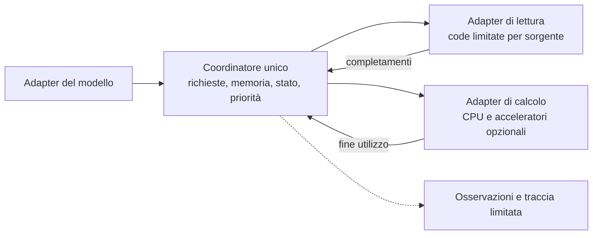
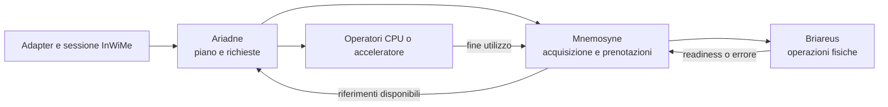
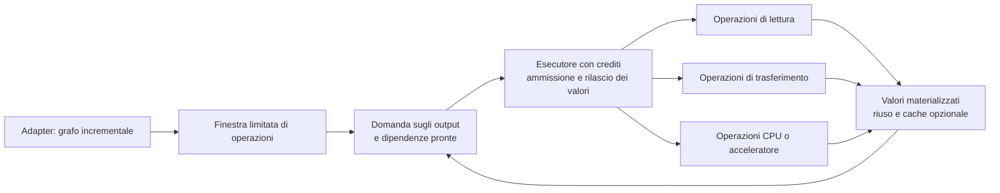

# InWiMe — Decisione architetturale: confronto delle alternative

**Data:** 7 novembre 2026.

**Stato:** decisione proposta, in attesa di revisione; attività limitata alla documentazione.

**Scelta raccomandata:** runtime compatto con coordinatore unico per lo stato operativo, adapter sostituibili per accesso ai dati e calcolo, concorrenza limitata nelle operazioni esecutive. La scelta è falsificabile con il prototipo descritto sotto.

## 1. Perimetro e base della decisione

InWiMe è il motore complessivo. Briareus, Mnemosyne, Ariadne e Iris identificano responsabilità concettuali; non costituiscono una partizione software obbligatoria. Le tre alternative seguenti cambiano la distribuzione dell'autorità, la rappresentazione dell'esecuzione e i contratti necessari. Non sono tre denominazioni dello stesso progetto.

Si confrontano disegni realizzabili, non implementazioni già misurate. I giudizi su complessità, debugging e prestazioni potenziali sono valutazioni progettuali. Nessuna alternativa è stata implementata o profilata per questa decisione.

Le evidenze [V2](../BENCHMARK_V2.md), [storage V2](../BENCHMARK_V2_STORAGE.md) e [M1a](../results/m1a-native-ext4-20261107T075250Z/REPORT.md) dimostrano streaming matriciale limitato in memoria e differenze fra percorsi di storage. Non confrontano le architetture qui descritte e non misurano un runtime LLM, il routing MoE o il costo di un coordinatore. Non vengono usate per assegnare punteggi prestazionali. Katana, Sabrent, 64 MiB e due buffer non determinano la struttura.

### Requisiti comuni, indipendenti dalla soluzione

- Checkpoint originali BF16/F16 immutabili; rappresentazioni native diverse solo se supportate esplicitamente. Nessuna quantizzazione implicita o copia completa necessaria al caricamento.
- Pesi e singoli tensori possono eccedere RAM e VRAM: tiling del calcolo, anche della riduzione, distinto da intervalli I/O e unità di cache. Anche attenzione, attivazioni e workspace devono avere un percorso limitato in memoria.
- CPU-only completo, senza inizializzazione CUDA obbligatoria; acceleratori opzionali con capacità e memoria temporanea dichiarate.
- Adapter responsabile di matematica, attenzione e routing. Prefill/decode e denso/MoE richiedono lo stesso contratto di dati, con dipendenze anche dinamiche.
- Stato mutabile isolato per sessione, budget globale della memoria controllata, cancellazione distinta dall'arresto fisico, backpressure e ammissione esplicita.
- Collocazione degli shard separata dall'identità dei tensori; limiti globali, per dispositivo e per risorse condivise. Nessuna distribuzione introdotta ora.

Questi sono criteri di ammissibilità. Un'alternativa che non li soddisfa non diventa accettabile grazie a maggiore velocità o semplicità.

## 2. Alternativa A — Runtime compatto con coordinatore unico

### Organizzazione e interfacce

Un coordinatore possiede le transizioni dello stato operativo: richieste, caricamenti condivisi, residenze, prenotazioni, avanzamento delle sessioni e lavoro pronto. L'adapter descrive incrementalmente operazioni e dipendenze; non costruisce obbligatoriamente un grafo pubblico. Il coordinatore emette lavoro verso adapter di lettura e di calcolo e riceve completamenti identificati.

Le interfacce di variazione iniziali sono: descrizione del modello, accesso a regioni del checkpoint e operazioni di calcolo. Allocatore, cache e selezione del lavoro sono dettagli interni con funzioni e strutture verificabili, senza propri protocolli asincroni pubblici.

Un solo contesto modifica lo stato operativo. Letture e kernel possono procedere concorrentemente: il coordinatore non esegue chiamate bloccanti né attende un kernel nel proprio ciclo. I completamenti usano record con capacità prenotata al dispatch, evitando che la coda diagnostica o un'allocazione tardiva impediscano il rilascio delle risorse.

### Percorso concreto

Dopo il routing, il coordinatore acquisisce riferimenti residenti oppure associa il consumatore a un caricamento esistente. Per un nuovo caricamento ammette una fase eseguibile, prenotandone il costo incrementale completo, e invia letture e trasferimenti. Quando la residenza richiesta è pronta può avviare il kernel. Soltanto dopo gli eventi di fine utilizzo libera o conserva i dati. La cache non è necessaria al funzionamento.

La fase include input, accumulatori, output, crescita dello stato, workspace e copie temporanee necessari al suo completamento, senza prenotare l'intero forward. Le attese di ammissione non trattengono prenotazioni parziali che impediscano alle fasi già ammesse di terminare. Lo speculativo ha una quota che preserva capacità per almeno una fase obbligatoria fattibile; se lo stato persistente rende impossibile anche quella fase, si rifiuta l'avanzamento prima di modificarlo. La riserva va calcolata dal fabbisogno dichiarato, non fissata a una dimensione universale.

### Vantaggi e costo

Le decisioni di ammissione e le transizioni sono locali: nessun protocollo fra cache, allocatore e scheduler per rendere atomica una decisione. Tracce deterministiche di eventi rendono riproducibili gli interleaving. Multi-NVMe aggiunge code e collocazioni, non nuovi proprietari dei dati.

Il costo è l'accoppiamento interno. Nuove politiche toccano il coordinatore; un errore nella sua macchina a stati ha un'area d'impatto ampia. Un ciclo troppo costoso può limitare l'invio dei lavori. Servono eventi aggregabili, funzioni interne piccole e nessuna logica specifica del modello o del driver nel coordinatore. La semplicità non deriva dal mettere tutto in una funzione.

## 3. Alternativa B — Architettura modulare corretta

### Organizzazione e interfacce

Le autorità sono incapsulate in moduli distinti, anche nello stesso processo e sullo stesso thread di controllo:

- Ariadne possiede piano, dipendenze, priorità e prefetch.
- Mnemosyne possiede allocazioni, residenze, riferimenti e caricamenti condivisi; la politica di cache è interna e sostituibile.
- Briareus possiede catalogo e risoluzione fisica, operazioni I/O, trasferimenti e relativi completamenti.
- Il runtime InWiMe possiede le sessioni e la validità dello stato mutabile; gli operatori possiedono la semantica e i requisiti dei kernel.
- Iris raccoglie osservazioni con memoria limitata. L'enforcement resta presso i proprietari delle risorse.

Il vantaggio rispetto ad A è l'ownership locale: la politica di cache può cambiare dietro l'interfaccia di Mnemosyne e il dispatch dietro quella di Briareus. Il costo è un protocollo: identità condivise, prenotazioni, promozioni di priorità, readiness, cancellazione e rilascio attraversano più autorità. Questi contratti esistono anche senza thread separati.

### Percorso concreto

Ariadne presenta una fase con fabbisogno dichiarato. Mnemosyne esegue lookup e associazione al caricamento condiviso, concedendo soltanto risorse incrementali. Briareus esegue le operazioni ammesse. Una richiesta obbligatoria che si associa a un prefetch deve aggiornare la priorità del caricamento e del lavoro fisico. InWiMe pubblica l'avanzamento della sessione solo al confine previsto.

La correttezza richiede una singola autorità per ogni transizione: non un caricamento condiviso distinto in ciascun modulo. Il controllo del fabbisogno complessivo non può emergere da budget autonomi sommati a posteriori. Le interfacce devono esprimere anche workspace, trasformazioni e fine utilizzo, senza lasciare queste informazioni implicite nei callback.

### Vantaggi e costo

Questa alternativa è adatta quando esistono già più politiche o implementazioni da sostituire e verificare indipendentemente. Favorisce evoluzione locale e lavoro su moduli distinti. Richiede però test di protocollo e integrazione oltre ai test locali. Il rischio iniziale è implementare molti oggetti intermedi prima di conoscere le esigenze di un forward reale. Le prestazioni non sono necessariamente inferiori ad A: il costo effettivo delle interazioni resta da misurare.

## 4. Alternativa C — Esecutore a grafo incrementale guidato dalla domanda

### Organizzazione e interfacce

L'unità centrale è un grafo limitato di operazioni e valori, non una richiesta coordinata fra sottosistemi nominati. Un valore identifica dati, rappresentazione, residenza e generazione. I nodi dichiarano input, output, workspace, dipendenze ed eventuali effetti sullo stato. Lettura, copia e calcolo sono tipi di operazione eseguiti da adapter diversi.

La richiesta di un output rende necessarie le sue dipendenze; l'esecutore ammette nodi pronti con crediti di memoria e capacità operativa. Non si espande l'intero modello per tutti i token. Il decode riutilizza schemi di grafo; il routing MoE aggiunge solo i rami selezionati entro una finestra con limite di metadati.

### Percorso concreto

Un nodo router produce gli esperti effettivi. L'adapter espande le dipendenze dei nodi esperto. Nodi identici di acquisizione dati condividono un valore materializzato; la cancellazione di un output ritira la domanda, ma lascia vivi nodi e valori necessari ad altri output o ancora in uso fisico. Lo stato è una catena di generazioni con dipendenze di effetto: un token non osserva uno stato parzialmente pubblicato.

L'ammissione deve considerare l'insieme necessario a produrre almeno un avanzamento, non solo i byte di output del prossimo nodo. Valori intermedi trattenuti possono altrimenti consumare i crediti e bloccare ogni nodo pronto. Occorrono regole per rilascio, ricomputazione o rifiuto e una dimostrazione sulle finestre ammesse. Canali limitati e grafo aciclico, da soli, non garantiscono il progresso.

### Vantaggi e costo

Dipendenze, trasferimenti e vita dei dati hanno una rappresentazione uniforme e ispezionabile. È una base plausibile per pianificazione congiunta di memoria e calcolo, più acceleratori e riuso tra richieste. I quattro nomi possono essere semplici viste funzionali dello stesso esecutore.

Si paga la costruzione di un piccolo runtime a grafo: identità dei valori, espansione dinamica, effetti, crediti, priorità e gestione della cache dei valori. Gli effetti mutabili non diventano corretti soltanto perché il grafo è dichiarativo. La finestra limitata riduce inoltre la visibilità necessaria alle ottimizzazioni globali. Per il primo forward è il maggiore investimento non ancora giustificato da evidenze.

## 5. Confronto rispetto ai requisiti

Le valutazioni sono qualitative e assumono le regole di correttezza specificate per ciascuna alternativa. Non si assegna un punteggio numerico privo di misure.

| Criterio | A — Coordinatore compatto | B — Moduli con autorità distinte | C — Grafo incrementale |
|---|---|---|---|
| Checkpoint oltre RAM/VRAM | Fasi e tile prodotte incrementalmente; finestre piccole | Contratto delle regioni e lease; costo completo attraversa le interfacce | Letture e tile come nodi; serve limitare anche il grafo |
| CPU-only e acceleratori | Stesso controllo, adapter di calcolo diversi | Stessi contratti fra moduli, backend CPU autonomo | Stesso grafo, esecutori diversi; nessun nodo obbligatoriamente CUDA |
| Denso e prefill | Ordine e riuso espliciti nel piano incrementale | Planner e cache specializzabili separatamente | Riuso degli input e vita degli intermedi rappresentati nel grafo |
| MoE e decode | L'adapter aggiunge lavoro dopo il router | Pianificazione dinamica con promozioni fra moduli | Espansione dinamica dei rami e schemi riutilizzabili; metadati da limitare |
| Stato mutabile | Una macchina a stati di sessione nello stesso controllo | Ownership InWiMe più contratto di memoria e completamento | Generazioni ed effetti espliciti; implementazione del commit comunque necessaria |
| Cancellazione e concorrenza | Un registro decide interessi, operazioni e rilascio | Protocollo fra consumatori, residenze e operazioni fisiche | Ritiro della domanda e riferimenti dei valori; gli effetti richiedono regole proprie |
| Memoria e progresso | Ammissione locale della fase completa; più semplice da ispezionare | Prenotazione coerente fra moduli; più casi di integrazione | Crediti e pianificazione dei valori vivi; maggiore onere di verifica |
| Uno o più storage | Mappa shard/sorgenti e code per dominio fisico | Briareus incapsula backend e code | Nodi di lettura associati a sorgenti e domini di capacità |
| Complessità iniziale | Minore; rischio di crescita del coordinatore | Intermedia; costo precoce dei protocolli | Maggiore; serve prima la rappresentazione eseguibile |
| Debugging | Replay centralizzato degli eventi | Tracce correlate fra autorità | Grafo ispezionabile, ma ordine dinamico ed effetti meno immediati |
| Testabilità | Test delle transizioni più adapter controllabili | Test locali forti, oltre a test di contratto e integrazione | Test di trasformazioni, esecutore, crediti ed effetti |
| Evoluzione | Estrazione successiva possibile, non gratuita | Buona località delle sostituzioni già previste | Buona uniformità per nuove operazioni; complessità della rappresentazione condivisa |

Tutte richiedono limiti su richieste pendenti, metadati, worker, staging e diagnostica. Nessuna può promettere progresso incondizionato se un backend non completa e non consente arresto fisico: il timeout termina l'interesse logico, mentre le risorse coinvolte restano protette. L'isolamento delle quote evita che un percorso bloccato monopolizzi anche quelli indipendenti.

## 6. Come ogni alternativa risolve i problemi P1/P2

La tabella confronta le soluzioni, senza ripetere la diagnosi Astra. Nessuna soluzione precedente viene assunta come obbligatoria.

| Problema da risolvere | A | B | C |
|---|---|---|---|
| Coerenza dello stato e fallimento intermedio | Stato della sessione nel coordinatore; commit al confine del token o invalidazione | InWiMe possiede validità e commit; Mnemosyne protegge la memoria; completamenti espliciti | Generazioni dello stato e dipendenze di effetto; pubblicazione solo della generazione valida |
| Cache hit, memoria e progresso | Lookup/pin prima della riserva incrementale; ammissione atomica della fase | Operazione di acquisizione Mnemosyne più contratto completo di ammissione | Valori già materializzati non richiedono un secondo credito; ammissione di un insieme che possa avanzare |
| Dedup e cancellazione | Un registro lega consumatori, caricamento e operazioni | Registro condiviso in Mnemosyne; Briareus conserva la vita fisica; notifiche di promozione/cancellazione | Domanda multipla sul valore; ritiro di un consumatore non elimina le altre dipendenze |
| Snapshot e integrità | Verifica al catalogo di accesso, chiavi di cache con identità del contenuto | Catalogo Briareus e identità canoniche negli altri moduli | Identità e versione entrano nei valori sorgente e nei nodi di acquisizione |
| Workspace, layout e trasferimenti | Dichiarati dall'adapter di calcolo e inclusi nella fase prima del dispatch | Contratto fra planner, memoria, trasferimenti e operatori | Nodi espliciti di trasformazione più requisiti dei kernel, inclusi nell'ammissione |
| Starvation su worker e dispositivi | Quote e dispatch nello stesso controllo | Ariadne impone priorità, Briareus garantisce quote e capacità concordate | Capacità per esecutore e dominio; selezione dei nodi pronti con riserva obbligatoria |
| Osservabilità limitata | Traccia derivata dallo stato autoritativo | Iris osserva i proprietari; non concede risorse | Eventi dei nodi e contatori dei crediti, separati dalla diagnostica facoltativa |

La garanzia dello snapshot è una scelta comune di accesso, non un vantaggio di una struttura. Per il piccolo prototipo si può verificare integralmente un manifest con hash, assumere sorgenti immutabili durante l'esecuzione e rifiutare cambiamenti rilevati. Una verifica iniziale non garantisce da sola l'assenza di successive modifiche esterne. Il livello di protezione per checkpoint reali va dichiarato; nessuna alternativa deve presentare la sola apertura read-only come prova d'immutabilità.

## 7. Scelta e alternative non selezionate

**Raccomando A per il primo runtime verificabile.** Il requisito prioritario è comporre streaming, stato e limiti di memoria in un forward corretto. Un'autorità unica riduce il numero di transizioni che devono essere coordinate fra proprietari distinti. Il controllo centralizzato non impone esecuzione seriale di letture e kernel.

La scelta assume che il lavoro di controllo per tile e completamento sia sostenibile e che l'adapter possa descrivere incrementalmente il modello senza richiedere una rappresentazione generale a grafo. Sono ipotesi da falsificare, non conclusioni dei benchmark storage.

**B non viene selezionata come struttura iniziale.** La separazione è utile quando le politiche hanno variazioni reali; oggi il protocollo fra moduli anticiperebbe molte decisioni prima di un forward completo. Non è scartata per un presunto costo prestazionale: può diventare preferibile se le sostituzioni di cache, pianificazione e trasferimento richiedono modifiche indipendenti frequenti. L'estrazione dovrà essere motivata da questi casi, non dai nomi.

**C non viene selezionata per il primo prototipo.** Offre la migliore rappresentazione esplicita delle dipendenze fra dati e operazioni, ma richiede di verificare un esecutore a grafo oltre al modello. Diventa candidata se l'esecuzione incrementale di A accumula dipendenze speciali, duplica la gestione dei valori vivi o impedisce una pianificazione congiunta necessaria. L'adozione di C comporterebbe una revisione dell'interfaccia dell'adapter, non un semplice refactoring interno.

I compromessi accettati con A sono: controllo concentrato, ottimizzazione iniziale limitata a una finestra piccola, politica di cache semplice e nessuna promessa di scalabilità illimitata del coordinatore. Non si accettano limiti fissi legati al Katana o rinunce ai requisiti di correttezza.

### Applicazione dei nomi nella scelta A

| Responsabilità concettuale | Forma iniziale proposta |
|---|---|
| Briareus | Funzioni di accesso, registro delle operazioni e adapter di lettura/trasferimento |
| Mnemosyne | Registro delle allocazioni e residenze, acquisizione dei riferimenti e politica interna di cache |
| Ariadne | Selezione delle fasi pronte e anticipazione limitata nello stesso coordinatore |
| Iris | Contatori e traccia limitata degli eventi |

Queste parti condividono il proprietario delle transizioni. Non hanno scheduler, bus di messaggi o budget autonomi. L'interfaccia esterna nasconde queste scelte, mantenendo accesso ai checkpoint e calcolo sostituibili. La semantica del modello e la validità della sessione restano responsabilità di InWiMe.

## 8. Primo prototipo verticale proposto

### Domanda sperimentale

Un solo controllo operativo può portare un piccolo decoder da checkpoint a output numerico, attraverso prefill e decode, mantenendo stato coerente e memoria limitata mentre letture e completamenti avvengono in ordine variabile?

La prima prova deve verificare questa domanda prima di ottimizzare throughput o caching predittivo. Non è un altro benchmark matriciale isolato.

### Percorso minimo

1. Un decoder sintetico dichiarato, con due blocchi causali e KV reale. La parte feed-forward ha una variante densa e una MoE minima con pochi esperti; il router matematico è deterministico e indipendente dal runtime. Nessuna pretesa di supporto a un modello commerciale o ufficiale.
2. Un checkpoint originale BF16 di fixture, con manifest e due shard. Obiettivo iniziale: non oltre 32 MiB nuovi su disco e budget delle allocazioni controllate intorno a 8 MiB; dimensioni esatte definite dal calcolo preventivo di stato, workspace e minima fase eseguibile. Questi valori sono parametri del test. Nessuna copia dei dataset da 5 GiB.
3. Reference residente separata dal processo del runtime. Stessi byte di peso e stessa matematica, con implementazione indipendente del forward di riferimento. Non usare il risultato di una tile del runtime come propria reference.
4. Prefill di una sequenza breve seguito da più passi di decode, confrontando output, intermedi e stato valido a ogni confine. CPU-only senza dipendenze CUDA operative.
5. Acquisizione dei dati tramite adapter in memoria e su file. Un adapter controllabile di test ritarda, riordina e fallisce le letture; gli stessi shard su file esercitano il percorso reale. Il coordinatore non riceve dettagli di mount o dispositivo.
6. Una fase eseguibile di calcolo per volta, con numero configurabile e limitato di letture in volo; una seconda sessione e una piccola anticipazione opzionale bastano a esercitare condivisione, priorità e cancellazione. L'anticipazione iniziale non richiede un predittore appreso.

Il budget delle allocazioni include pesi residenti, staging, stato, output, workspace e metadati controllati. RSS, librerie, page cache e paging host si riportano separatamente. Il prototipo non può promettere che un limite dell'allocatore sia un limite all'intera memoria del processo.

Un checkpoint da 32 MiB superiore al budget controllato dimostra streaming rispetto a quel budget; **non dimostra pesi superiori alla RAM fisica o alla VRAM reale**. Queste proprietà richiederanno successive prove autorizzate di integrazione, con spazio e condizioni definiti. Il benchmark V2 da 5 GiB non dimostra automaticamente che il nuovo runtime le soddisfi.

### Ipotesi, osservazioni e condizioni di falsificazione

| Ipotesi | Prova futura e criterio di fallimento |
|---|---|
| Il controllo resta indipendente dal modello | Usare le varianti densa e MoE. Fallisce se il coordinatore deve conoscere l'equazione del router o casi specifici dei layer per gestire i dati |
| Una finestra piccola basta a descrivere prefill e decode | Variare sequenza e numero di passi. Fallisce se richieste o metadati crescono con tutto il futuro lavoro invece di restare entro i limiti dichiarati |
| L'ammissione evita attese circolari | Cache piena, KV crescente e budget vicino al minimo. Ogni fase fattibile avanza con backend che completano; ogni fase impossibile viene rifiutata prima di modificare lo stato. Un'attesa senza operazioni capaci di liberare risorse è un fallimento |
| I consumatori sono indipendenti | Due sessioni richiedono gli stessi pesi; cancellarne una durante la lettura. Fallisce se si interrompe l'altra, si completano due volte le richieste o si riusa memoria ancora in uso |
| Lo stato non avanza parzialmente | Iniettare errore fra i due blocchi. Il primo prototipo invalida la sessione se non può garantirne la coerenza; non effettua retry automatico del token su stato parziale |
| Le politiche non cambiano la matematica | Cache e anticipazione on/off, tile diverse anche lungo la riduzione. Confronto con reference secondo tolleranze dichiarate prima della prova, specifiche di operatori e accumulo; tolleranze non allargate dopo un errore |
| La collocazione è sostituibile | Sorgenti con latenze e identità distinte, poi due percorsi già disponibili se autorizzati. Fallisce se serve modificare il piano del modello. Due sorgenti simulate verificano il controllo, non il parallelismo di due NVMe fisici |

Un'esecuzione CPU completamente seriale non basta a verificare cancellazione e completamenti fuori ordine: questi casi devono attraversare gli adapter controllabili e la stessa macchina a stati del percorso reale. Un dispositivo di test può simulare readiness ritardata e fine utilizzo, ma non certifica CUDA.

### Politica iniziale di stato e cancellazione

Si pubblica l'avanzamento della sessione soltanto al confine di un token completato. Se un errore o una cancellazione interrompe aggiornamenti in-place, la sessione diventa inutilizzabile; non si implementano subito rollback, spill o recupero trasparente. Questa scelta riduce il prototipo mantenendo una semantica verificabile.

La cancellazione ritira l'interesse del consumatore. Le operazioni fisiche già avviate vengono drenate o arrestate soltanto se l'adapter lo garantisce; i buffer restano contabilizzati fino alla fine dell'utilizzo. Le prove distinguono esito logico, drenaggio e rilascio.

### Acceleratore e sufficienza del prototipo

Il primo percorso numerico è CPU. La stessa interfaccia deve descrivere destinazione, layout, workspace e evento di fine utilizzo; non contiene obblighi CUDA. Un successivo incremento minimo potrà eseguire una proiezione tiled sulla GPU usando la stessa ammissione, senza cambiare routing o semantica di sessione. Finché questo incremento non è verificato, l'opzionalità dell'acceleratore è un contratto progettato e parzialmente testato, non un backend GPU dimostrato.

Il prototipo rifiuta le ipotesi sbagliate tramite errori numerici, violazioni dei limiti, transizioni invalide e dipendenze improprie; non tramite un obiettivo arbitrario di token/s. Un bug locale richiede correzione. Una necessità ricorrente di duplicare autorità, conoscere la semantica del modello nel controllo o mantenere dipendenze generali ad hoc richiede invece di riaprire la scelta fra A, B e C.

## 9. Evoluzione e limiti della decisione

Prima di dichiarare A adatta a carichi più concorrenti, una futura valutazione autorizzata dovrà misurare tempo di controllo per completamento, attesa nelle code e saturazione dei backend. Se il coordinatore impedisce di alimentarli, si valuterà se il costo risieda nel suo algoritmo, nelle transizioni fra moduli o nella granularità dei lavori. Nessuna di queste diagnosi è ricavabile dai tempi M1a.

La successiva verifica fisica multi-NVMe non richiede subito replica o distribuzione: bastano shard collocati su sorgenti indipendenti e domini di risorse corretti. Un backend remoto futuro richiederà nuove decisioni su guasti, integrità e autenticazione anche se l'identità logica resterà stabile.

La [proposta originale](BRIAREUS_ARCHITECTURE_PROPOSAL.md) resta una fonte di alternative e requisiti, invariata. La revisione Astra e le definizioni funzionali fornite dall'utente in questa sessione costituiscono input della decisione; non provano la superiorità di una partizione software. Questo documento propone A e il relativo criterio di verifica. Implementazione, creazione delle fixture, download e nuove misure restano attività successive da autorizzare.
