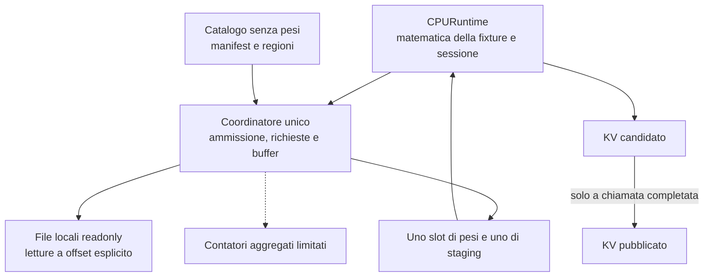

# InWiMe — Incremento 2: primo runtime out-of-core CPU

**Stato:** implementato e revisionato per la fixture dell'incremento 1; consolidamento Git autorizzato dall'utente, push escluso. Architettura A adottata come ipotesi iniziale, senza framework autonomi per i quattro nomi funzionali.

## Risultato e perimetro

Entrambe le varianti, densa e MoE, eseguono realmente un prefill di tre token seguito da tre chiamate di decode, sugli stessi checkpoint BF16 dell'incremento 1. I pesi vengono letti su richiesta da file aperti in sola lettura, senza caricare interi tensori, shard o checkpoint in memoria. Lo slot dei pesi espansi è di **40 byte**, a fronte di payload BF16 di 11.872 byte e 21.280 byte. Il lettore verifica inizialmente gli hash con una scansione completa ma a memoria limitata, distinta dalle letture selettive dell'inferenza.

La suite dopo la revisione comprende **68 test superati: 24 del riferimento e 44 del runtime**. Nessun test finale fallito o saltato. La fixture rimane molto più piccola della RAM fisica: questa prova dimostra streaming e residenza limitata rispetto ai budget dichiarati, non capacità oltre la RAM fisica, supporto a un LLM ufficiale o velocità d'inferenza utile.

## File introdotti

| File | Responsabilità |
|---|---|
| `inwime_runtime/__init__.py` | Interfaccia pubblica minima e tipi d'errore |
| `inwime_runtime/core.py` | Catalogo, piano di memoria, coordinatore, letture e riferimenti ai buffer |
| `inwime_runtime/decoder.py` | Esecuzione CPU indipendente, sessione e pubblicazione del KV |
| `tests/test_runtime_cpu.py` | Confronti numerici, budget, fault injection e ciclo di vita |
| `tools/verify_increment2.py` | Acquisizione in processi separati per runtime e riferimento |
| `results/increment2/verification-reviewed.json` | Evidenza dopo le correzioni della revisione finale |
| `results/increment2/verification-final.json` | Acquisizione alla chiusura dell'implementazione, prima della revisione |
| `results/increment2/verification.json` | Prima acquisizione, prima del controllo della misura RSS del processo padre |
| `results/increment2/verification-clean-processes.json` | Acquisizione intermedia con RSS separato, prima di completare la riserva dei metadati di bootstrap |
| Questo documento | Contratti, esecuzione, risultati e limiti |

I JSON precedenti sono conservati come acquisizioni della lavorazione; il riferimento per i valori dopo la revisione è `verification-reviewed.json`. Nessun file del riferimento, fixture originale, dipendenza fissata o benchmark precedente viene modificato.

## Architettura effettiva



Il coordinatore è l'unica autorità su prenotazioni, richieste fisiche e riuso dei buffer. L'esecutore conosce la matematica e lo stato logico della sessione, consumando solo regioni concesse dal coordinatore. Entrambi operano nello stesso thread proprietario; non ci sono scheduler indipendenti, bus di messaggi, cache dei pesi o worker concorrenti. L'uso da thread diversi e l'esecuzione rientrante sono rifiutati.

Il catalogo legge soltanto il manifest, verifica configurazione, nomi, forme, dtype, offset, lunghezze, copertura degli shard e assenza di sovrapposizioni. L'input del manifest è limitato a 64 KiB per questo formato di fixture. Non è un limite strutturale al futuro catalogo di InWiMe. I pesi non sono parte del catalogo.

Il formato descrive ogni tensore interamente in un singolo shard. Una regione può attraversare righe della matrice, ma non superare gli elementi del proprio tensore: viene rifiutata prima dell'I/O anche se nello shard seguono altri dati. I test della revisione verificano il primo e l'ultimo elemento di ogni tensore, inclusi gli estremi dei due shard, e il passaggio fra sorgenti sia con `preadv` sia con il fallback `readv`. Tensori suddivisi su più shard non sono rappresentati da questo formato e non vengono introdotti qui.

L'interfaccia di lettura riceve offset e destinazione già allocata; `os.preadv` evita copie del payload in oggetti `bytes`. È disponibile un fallback POSIX sincrono con posizione del file e `readv`. Le sorgenti devono essere file regolari, non dispositivi raw; i collegamenti simbolici degli shard sono rifiutati dove `O_NOFOLLOW` è disponibile. Questa implementazione del backend è POSIX locale, non una dimostrazione di portabilità Windows nativa o di trasporto remoto.

L'identità logica delle regioni non contiene nomi di dispositivi. Collocazioni differenti e nuovi esecutori potranno essere introdotti senza cambiare il routing del modello; apertura delle sorgenti, allocatori e completamenti richiederanno però adapter ulteriori. Non si dichiara già dimostrata la compatibilità GPU, multi-NVMe concorrente o distribuita.

## Granularità e vita dei dati

La configurazione della prova finale è `capacity=6`, `tile_elements=5`, `read_elements=2`:

I 40 byte derivano dal parametro `tile_elements=5`, non da un limite fisso del motore; i test esercitano anche tile di tre e sette elementi. Il singolo slot è una restrizione di questa implementazione sincrona, non un parametro attualmente configurabile né un requisito generale dell'architettura A. Aumentare il numero di slot richiederà nuove prenotazioni e verifiche del ciclo di vita; non viene implementato in questa revisione.

- Il calcolo di una riga di matrice è suddiviso lungo la riduzione in gruppi di massimo cinque coefficienti, con code parziali per le dimensioni 16 e 24.
- Una regione contiene fino a cinque pesi, espansi esattamente da BF16 a FP64: 40 byte di capacità.
- La regione è riempita tramite letture fisiche richieste al backend di massimo due coefficienti BF16, cioè quattro byte per chiamata. Lettura e tile di calcolo sono quindi parametri distinti.
- La cache dei pesi è assente. Il rilascio rende riutilizzabile lo slot; non libera o rialloca l'arena a ogni lettura. Nessuna politica di cache è implicita in questa dimensione.

Gli stati della richiesta sono `READING → READY → IN_USE → RELEASED`, oppure `FAILED`. `READY` significa che tutti i byte richiesti sono stati consegnati e decodificati; non indica un futuro completamento GPU. Una lettura parziale è un errore, mai una regione completa. Il riferimento contiene una generazione e rifiuta accessi dopo il rilascio. Un secondo acquisto è rifiutato finché lo slot è in uso.

Logits, intermedi, routing e KV sono esposti mediante viste readonly valide fino al rilascio del risultato. Finché il risultato è acquisito, una nuova chiamata è rifiutata. Chi necessita snapshot duraturi deve copiarli esplicitamente; le copie diagnostiche del chiamante non fanno parte delle arene del motore. Come per normali viste borrowed, una vista già estratta non deve essere usata dopo il rilascio. Non è una barriera di sicurezza contro manomissioni degli oggetti Python.

Questi stati separano disponibilità, consumo e riuso e rendono verificabili le transizioni. Non implementano cancellazione asincrona, deduplicazione concorrente, trasferimenti device o eventi fuori ordine.

## Matematica e stato mutabile

La specifica resta quella della fixture: due blocchi prenorm, RMSNorm, attenzione causale multi-head, embedding posizionali appresi, SwiGLU e variante MoE top-2 su tre esperti. Sono proprietà dell'adapter di test. Il router sceglie i logits più grandi e preferisce l'indice minore nei pareggi; applica softmax ai soli esperti selezionati. Solo dopo questa scelta si acquisiscono le loro matrici.

L'esecuzione è implementata separatamente con operazioni scalari FP64 e matrici lette in tile. Non importa NumPy, PyTorch o funzioni del riferimento. BF16 viene decodificato dalla formula segno/esponente/frazione senza quantizzazione o conversione lossy. I test confrontano dati, intermedi e KV contro il riferimento indipendente che usa NumPy; i suoi 24 test analitici e scalari restano invariati.

Il prefill elabora i token in ordine causale. Per ogni layer e token, Q è temporaneo e K/V sono scritti nel banco candidato; l'attenzione vede soltanto le posizioni da zero a quella corrente. Si usa una softmax stabilizzata in due passaggi senza materializzare l'intera matrice di attenzione.

Due banchi KV preallocati consentono di conservare il prefisso pubblicato mentre si elabora una chiamata. La pubblicazione di banco, lunghezza e generazione è un singolo aggiornamento di riferimento dopo il completamento dell'intera chiamata. Un prefill in errore non pubblica neppure i token candidati già calcolati. Dopo un errore I/O o di calcolo la sessione viene invalidata, senza retry automatico; il KV precedentemente pubblicato resta invariato e verificabile. Errori di input o capacità sono rifiutati prima dell'elaborazione e non invalidano la sessione.

La revisione estende questa proprietà alle interruzioni locali rilevate prima del ritorno della chiamata: se un `BaseException`, incluso `KeyboardInterrupt`, viene sollevato dopo il cambio di banco ma prima del ritorno, si ripristina il descrittore precedente, si libera lo stato del risultato e si invalida la sessione. I test iniettano l'interruzione durante una lettura e immediatamente dopo la pubblicazione, verificando digest e lunghezza del vecchio KV e la possibilità di chiudere le risorse. Non è un servizio di cancellazione asincrona né una garanzia contro terminazioni forzate del processo o interruzioni ripetute durante la gestione dell'errore.

## Budget e significato del minimo

`CPURuntime.minimum_plan(...)` calcola le arene richieste dalla configurazione. `plan.budget()` restituisce esattamente i massimali necessari al piano. Un byte in meno sul totale o su una qualsiasi categoria provoca un errore prima delle letture dei pesi, inclusa la scansione di integrità. Questo è il **minimo ammesso da questa implementazione preallocata**, non il minimo teorico fra tutti gli algoritmi possibili.

| Categoria, byte riservati | Denso | MoE |
|---|---:|---:|
| Pesi espansi | 40 | 40 |
| Staging BF16 | 4 | 4 |
| Attivazioni, output e tracce numeriche | 4.048 | 4.584 |
| KV pubblicato e candidato | 6.144 | 6.144 |
| Accumulatori | 72 | 72 |
| Workspace numerico aggiuntivo | 0 | 32 |
| Metadati e riserva di controllo | 34.950 | 52.286 |
| **Totale riservato** | **45.258** | **63.162** |

Le dimensioni numeriche sono ricavate da `array.itemsize × len(array)` e confrontate nei test con le categorie del piano. Le attivazioni includono i buffer degli output e delle osservazioni intermedie; il KV include entrambi i banchi, non solo il prefisso usato. I metadati comprendono il catalogo, le rappresentazioni conosciute del bootstrap, intestazioni delle arene, contatori per tensore e una riserva fissa per il controllo, proporzionata anche a capacità e descrittori. La parte persistente ispezionata nel resoconto è 17.102 byte per il denso e 23.845 per MoE, sotto le rispettive riserve.

Il totale può superare il payload binario di questa fixture minuscola: oggetti Python, metadati e stato hanno un costo reale. **Il budget separato dei pesi resta di 40 byte**, quindi non permette di trasformare lo spazio assegnato ai metadati in una copia residente del checkpoint. Il buffer BF16 equivalente contiene al massimo dieci byte di pesi per regione; anche lo staging occupa solo quattro byte. Gli hash sono calcolati incrementalmente nello stesso staging.

La contabilità non è un limite all'intero heap Python: l'indicizzazione del manifest precede l'ammissione delle arene, la dimensione dell'input è controllata e le rappresentazioni note sono incluse nella riserva, ma i temporanei interni del parser JSON, l'interprete, gli stack e l'allocatore non sono tutti intercettati. I temporanei scalari sono limitati dal percorso sincrono; non esistono liste crescenti di richieste o di pesi. Una garanzia byte per byte su tutto l'heap o sul picco di bootstrap richiederebbe ulteriori strumenti o un allocatore di livello inferiore. Non viene presentata come dimostrata da questi contatori.

La memoria globale, la page cache e gli eventuali altri carichi dell'host restano fuori dal budget. Non si ricava l'assenza di paging dal solo rispetto delle arene.

## Tolleranze fissate prima dei confronti

Il percorso implementato è FP64 con pesi BF16 originali. Si applica `abs(a-b) <= atol + rtol*abs(reference)` con `u=2^-52`:

| Confronto | atol | rtol |
|---|---:|---:|
| Logits | `8192u` ≈ `1,82e-12` | `8192u` |
| Output dei blocchi | `4096u` ≈ `9,09e-13` | `4096u` |
| K/V | `2048u` ≈ `4,55e-13` | `2048u` |
| Probabilità del router | `128u` ≈ `2,84e-14` | `256u` ≈ `5,68e-14` |
| Indici degli esperti e generazioni discrete | Esatto | Esatto |

Le costanti sono in `tools/verify_increment2.py` e sono state fissate prima della prima prova del runtime. Le riduzioni sequenziali delle righe e dell'attenzione hanno ordini diversi dal BLAS del riferimento; normalizzazioni, non linearità e due blocchi amplificano l'errore. I margini aumentano da KV a intermedi e logits; la softmax di due logits ha un margine minore. Il termine assoluto protegge valori prossimi a zero. Sono criteri della fixture, non un limite rigoroso universale, e non costituiscono tolleranze FP32/mixed precision. Nessuna soglia è stata allargata dopo un fallimento.

## Risultati finali osservati

Acquisizione separata per variante e implementazione, il 7 novembre 2026. Sequenza `[1,7,4,7,2,11]`: prefill di tre token e tre decode. Gli output del riferimento e del runtime risiedono in processi distinti; il processo padre importa NumPy per il confronto solo dopo aver eseguito tutti i figli, evitando di trasferire ai figli successivi un high-water mark del padre già aumentato.

| Misura | Denso | MoE |
|---|---:|---:|
| Payload checkpoint BF16 | 11.872 byte | 21.280 byte |
| Picco capacità slot pesi FP64 | 40 byte | 40 byte |
| Letture consegnate per integrità iniziale | 11.872 byte | 21.280 byte |
| Letture consegnate per inferenza | 59.520 byte | 88.320 byte |
| Totale payload consegnato dal backend | 71.392 byte | 109.600 byte |
| Chiamate backend, integrità inclusa | 21.376 | 32.536 |
| Richieste di regioni completate e rilasciate | 7.248 | 10.656 |
| Massima lettura backend richiesta | 4 byte | 4 byte |
| Massimo errore assoluto logits | `2,33e-15` | `1,69e-15` |
| Massimo errore output dei blocchi | `2,66e-15` | `3,55e-15` |
| Massimo errore KV | `1,89e-15` | `2,11e-15` |
| Massimo errore probabilità router | n/a | `3,33e-16` |
| VmHWM runtime, snapshot `/proc/self/status` | 21.832 KiB | 21.924 KiB |
| `ru_maxrss` runtime | 21.660 KiB | 21.804 KiB |
| `ru_maxrss` riferimento separato | 36.976 KiB | 37.136 KiB |

I contatori I/O sono byte effettivamente restituiti alle destinazioni del motore, non byte NAND o letture fisiche del dispositivo. L'integrità iniziale legge anche gli esperti non selezionati, ma senza renderli residenti. Durante l'inferenza un test dedicato verifica che si leggano solo gli esperti effettivamente selezionati. Su sei token tutti gli esperti possono essere selezionati almeno una volta.

Le letture sono buffered, senza certificazione cold. `/proc/self/io` non è disponibile nell'ambiente del worker: il JSON riporta `null`, senza inventare una misura fisica. Page cache e memoria globale del sistema non sono misurate. I due indicatori RSS sono osservazioni distinte non sommabili, acquisite a fine worker prima della serializzazione JSON finale; comprendono interprete e copie diagnostiche, non soltanto le arene. VmHWM è circa 21,4 MiB, distinto dai 45/63 kB riservati dal piano. Nessuna CUDA inizializzata e nessuna misura VRAM effettuata.

Le chiamate minuscole e il controllo delle firme dei file a ogni lettura sono deliberatamente conservativi. Non si misurano banda ottimale, throughput o token/s. Alla chiusura entrambi i casi hanno zero regioni attive, zero richieste fallite e zero buffer numerici ancora posseduti dal coordinatore; i contatori e i piccoli descrittori possono restare disponibili nell'oggetto per il resoconto.

## Verifiche e limiti degli errori

La suite verifica minimo esatto e rifiuto sotto budget per categoria, tagli lungo la riduzione, code di tile, regioni oltre riga, estremi dei tensori e shard su entrambi i percorsi POSIX di lettura, forme KV, prefill completo/chunked/decode, risultati readonly e scadenza dei riferimenti. Verifica anche routing e pareggi nel runtime, esclusione degli esperti non scelti, token/capacità invalidi, corruzione/troncamento/sovrapposizioni del checkpoint, pesi non finiti, cambiamenti delle sorgenti dopo l'apertura, short read, errori I/O, interruzioni locali, rilascio dei descrittori e uso dal thread sbagliato.

Il test di fallimento del calcolo interrompe la chiamata dopo aver già prodotto un token candidato completo. Il digest del KV pubblicato e la lunghezza restano invariati e la sessione viene invalidata. Non è soltanto una prova di validazione prima dell'elaborazione. Le modifiche dei file per fault injection riguardano esclusivamente copie temporanee delle fixture.

SHA256 iniziale più confronto di dimensione, inode e timestamp prima/dopo ciascuna lettura rilevano le alterazioni ordinarie provate. Non sono una snapshot immutabile garantita dal filesystem contro modifiche ostili concorrenti. Il manifest fornito è una radice di fiducia, non un documento autenticato. Non è garantito il progresso se il filesystem o il backend restano bloccati: l'assenza di attese circolari per memoria non rende cancellabile una syscall.

## Riproduzione

Il runtime usa soltanto la libreria standard Python. Per confronto e test si riusa `requirements-reference.txt`, senza nuove dipendenze o modifiche all'ambiente di sistema. Ambiente verificato: CPython 3.14.4, NumPy 2.3.5, pytest 9.0.2 nel venv isolato dell'incremento 1. Per un ambiente nuovo:

```bash
python3 -m venv /tmp/inwime-inc2-venv-new
/tmp/inwime-inc2-venv-new/bin/python -m pip install -r requirements-reference.txt
OPENBLAS_NUM_THREADS=1 OMP_NUM_THREADS=1 PYTEST_DISABLE_PLUGIN_AUTOLOAD=1 /tmp/inwime-inc2-venv-new/bin/python -m pytest -q tests/test_reference_decoder.py tests/test_runtime_cpu.py
OPENBLAS_NUM_THREADS=1 OMP_NUM_THREADS=1 /tmp/inwime-inc2-venv-new/bin/python -m tools.verify_increment2 --output /tmp/inwime-inc2-verification-new.json
```

Eseguire dalla radice del repository. Il comando di acquisizione rifiuta un output già esistente. Non servono dataset da 5 GiB, build del benchmark, GPU o mount particolari. La suite dopo la revisione ha riportato **68 passed in 2,49 s**, senza cambiare il riferimento. Il resoconto non certifica altre versioni di Python, altri OS o tutti i possibili input numerici.

## Revisione mirata prima del commit

La revisione ha riprodotto due difetti con quattro test inizialmente falliti: l'interruzione dopo il cambio del banco lasciava il nuovo KV pubblicato e poteva impedire la chiusura; il confronto usava uno `zip` che poteva omettere silenziosamente una componente K/V mancante. Le sole correzioni operative ripristinano la pubblicazione in caso d'interruzione prima del ritorno e richiedono esattamente due componenti K/V per layer nel verificatore. Non sono state cambiate matematica, tolleranze, precisione, granularità o capacità.

I dieci test mirati aggiunti comprendono le regressioni di cancellazione e verifica K/V incompleta, oltre ai confini di tensor/shard. Dopo le correzioni: **10 test mirati superati**, poi **68 test complessivi superati**, nessun fallimento finale. Una nuova acquisizione in `verification-reviewed.json` conferma gli stessi byte di lettura, le stesse riserve e gli stessi errori numerici; gli artefatti precedenti sono conservati senza riscriverli.

La revisione conferma l'assenza di caricamenti integrali dei pesi nei percorsi del runtime. Il manifest viene letto e indicizzato integralmente; la scansione SHA256 percorre tutti gli shard ma usa soltanto lo staging limitato. Le copie residenti nel riferimento e quelle temporanee dei test di corruzione non appartengono al percorso di inferenza e non vengono usate per dichiararne la residenza. La contabilità resta quella delle arene e della riserva di metadati, non un tetto dell'intero heap o dell'RSS. Il package runtime non importa codice del riferimento; il verificatore esporta i due risultati separatamente e non calcola output del modello condivisi.

Esempio minimo dell'interfaccia:

```python
from inwime_runtime import CPURuntime

path = 'fixtures/reference_decoder/moe'
plan = CPURuntime.minimum_plan(path, capacity=6, tile_elements=5, read_elements=2)
with CPURuntime(path, budget=plan.budget()) as engine:
    with engine.prefill([1, 7, 4]) as output:
        print(list(output.logits))
    for token in [7, 2, 11]:
        with engine.decode(token) as output:
            print(list(output.logits))
    print(engine.stats())
```

Il valore del minimo può variare con interprete, metadati e lunghezza del percorso: si usa il piano calcolato, non si codificano i numeri della tabella come costanti architetturali.

## Cosa dice questa prova sull'alternativa A

La prova conferma che una sola autorità di memoria/richieste e una finestra minima di esecuzione bastano per comporre il forward della fixture, il routing dinamico e l'aggiornamento coerente del KV. Prenotare tutte le arene prima delle letture evita attese circolari dovute ad acquisizioni parziali; un risultato non rilasciato provoca un errore esplicito anziché un'attesa infinita. Non occorrono quattro framework o un esecutore a grafo per questa proprietà.

Emergono costi concreti: metadati Python grandi rispetto al modello minuscolo, doppio KV, molte piccole letture ripetute, serializzazione dei token e scansione completa per integrità. Non sono misure sufficienti per decretare la superiorità prestazionale di A o il fallimento di B/C. Una futura necessità di più sessioni, sovrapposizione I/O/calcolo o backend diversi dovrà verificare se il coordinatore mantiene interfacce contenute e progresso con risorse condivise.

Non sono implementati cache dei pesi, scheduling concorrente, autotuning, prefetch predittivo, accelerazione o distribuzione. Il confronto futuro fra inferenza distribuita e repliche indipendenti resta un requisito distinto per latenza per sessione e throughput aggregato. Questo incremento si ferma al runtime CPU della fixture.
