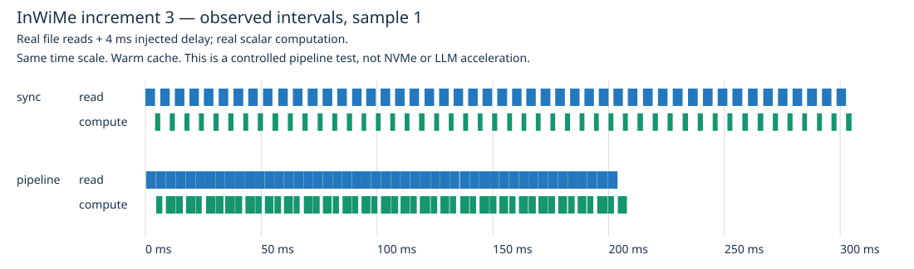

# InWiMe — incremento 3: pipeline CPU limitata in memoria

Data: 12 novembre 2026. Base locale: `05c6ab2`, `main`, inizialmente pulito.
Questo incremento termina alla pipeline CPU della fixture. Durante l'implementazione
non sono stati eseguiti commit o push, download di modelli, installazioni o interventi
sui dischi. Il successivo consolidamento Git autorizza un unico commit locale;
restano esclusi push e avvio dell'incremento 4.

## Risultato e perimetro

Il runtime mantiene il percorso sincrono come default e aggiunge `io_mode='pipeline'`.
Letture su worker e calcolo scalare sul thread proprietario possono sovrapporsi.
Matematica, ordine delle riduzioni, routing e commit dei due banchi KV restano quelli
dell'incremento 2. I risultati concorrenti sono **identici bit per bit** al sincrono
nelle prove; le tolleranze FP64 del riferimento indipendente non sono cambiate.

Il vantaggio esiste nel carico controllato: **308,39 → 211,11 ms**, mediana di cinque
campioni, con **164,37 ms di intersezione temporale** tra lettura e calcolo. Le fixture
decoder sono invece circa cinque volte più lente con la pipeline. Non si deduce
alcuna accelerazione di un LLM grande o della banda del dispositivo da questi dati.

Codice: `inwime_runtime/pipeline.py`, `telemetry.py`, integrazione in `core.py` e
`decoder.py`. Test: `tests/test_pipeline_cpu.py`. Riproduzione: nuovo verificatore
`tools/verify_increment3.py` e renderer `tools/report_increment3.py`. I benchmark C++,
gli strumenti precedenti, le fixture, il riferimento e gli artefatti storici non
sono stati modificati. La watchlist ha fornito il principio T02 e il vincolo del
prefetch successivo al routing; non sono stati importati framework o nuove tecniche.

## Interfaccia e pianificazione

```python
from inwime_runtime import CPURuntime

path = 'fixtures/reference_decoder/moe'
options = dict(io_mode='pipeline', in_flight=2, io_workers=1,
               tile_elements=32, read_elements=16, trace_capacity=0)
plan = CPURuntime.minimum_plan(path, **options)
with CPURuntime(path, budget=plan.budget(), **options) as engine:
    with engine.prefill([1, 7, 4]) as output:
        print(list(output.logits))
    with engine.decode(7) as output:
        print(list(output.logits))
    print(engine.stats())
```

`in_flight` comprende tutte le richieste ammesse: accodate, in lettura, pronte e
in uso. Default due slot; un solo worker basta per sovrapporre I/O e CPU. Più worker
permettono anche completamenti fuori ordine. `1 <= io_workers <= in_flight`;
un solo slot è ammesso come caso degenere e verificato numericamente. Nessuna
riduzione silenziosa del piano se il budget è insufficiente: il chiamante può
scegliere esplicitamente un piano più piccolo o `io_mode='sync'`.

L'adapter emette un iteratore pigro delle tile certamente necessarie all'operazione
corrente. Il coordinatore ammette al massimo `in_flight` elementi e li consuma
nell'ordine matematico originale. Il lookahead attraversa le righe di una matrice,
senza materializzare tutte le richieste. Non anticipa operazioni del token seguente.
Per MoE ogni `_ffn` riguarda solo un esperto già selezionato dal routing effettivo.
La scansione iniziale SHA256 legge comunque tutti gli shard, separatamente
dall'inferenza selettiva. Non esistono predittori, cache dei pesi o letture speculative.

La superficie di controllo `engine.control` espone `submit`, `poll`, `wait`, `cancel`,
`drain`, `acquire`, `stream`, `trace`. `submit` non attende risorse: solleva
`BackpressureError` se tutti gli slot sono occupati. `wait` attende solo la richiesta
indicata. `stream` richiede ownership esclusiva degli slot e mantiene progresso FIFO:
nessun nuovo prefetch scavalca il lavoro obbligatorio. Un consumatore che trattiene
un lease riceve backpressure, non provoca una prenotazione parziale in attesa circolare.

## Ownership, buffer e cancellazione

Una sola autorità modifica stati delle richieste, ownership e contatori: il thread
proprietario del runtime. Lo stesso contesto pubblica il descrittore KV. I worker
ricevono un `ReadJob` e una destinazione esclusiva; producono soltanto il record di
completamento e il relativo segnale. La sincronizzazione del trasporto e i contatori
diagnostici non diventano autorità dello stato operativo.

| Fase | Proprietà e transizione |
| --- | --- |
| Libero | Slot senza richiesta; nessun job o consumatore può scrivere nell'arena. |
| `READING` | Prenotazione integrale di pesi, staging e richiesta prima del dispatch; comprende la coda. |
| Completamento fisico | Il worker termina ogni accesso alla destinazione e cancella i suoi argomenti prima di segnalare. Il proprietario importa esito e byte. |
| `READY` | Tutti i byte richiesti sono disponibili; nessun lease se c'è errore o short read. |
| Espansione | Il proprietario converte BF16 esattamente in FP64. Un valore non finito interrompe l'operazione prima del lease. |
| `IN_USE` | Lease esclusivo dei pesi di quello slot. L'API restituisce scalari, senza esportare la sua arena. |
| `RELEASED` | Fine del consumatore; solo ora lo slot è riutilizzabile. Release idempotente, accessi scaduti respinti. |
| `FAILED` | Richiesta fallita contata una sola volta; nessuna pubblicazione di pesi parziali o KV candidato. |
| Cancellazione | Interesse ritirato; le richieste non iniziate vengono scartate dal worker, quelle avviate terminano il syscall corrente prima del rilascio. |

Le letture corte sono errori espliciti, senza completamenti validi parziali o retry
silenziosi. Byte effettivamente restituiti e tentativi di lettura restano contabilizzati,
anche per richieste cancellate/fallite. Prima e dopo le letture si controlla l'identità
del file aperto. L'espansione BF16 condivisa non introduce arrotondamento o quantizzazione.

`prefill(..., cancel_event=threading.Event())` e `decode` accettano un segnale esterno;
solo il proprietario applica la cancellazione. I punti di controllo sono prima delle
richieste, durante l'attesa e prima del commit KV. Anche `KeyboardInterrupt` nei worker
viene propagato dopo il completamento fisico. Un errore invalida la sessione e lascia
il KV pubblicato precedente intatto. La chiusura del generatore rilascia il lease corrente
e drena il lookahead; la chiusura del runtime drena prima di chiudere file e arene.
Un lease ancora in uso impedisce `close`/`drain`. Le viste dell'output conservano il
contratto precedente: prestito valido solo fino a `RuntimeResult.release()`.

Un syscall del backend non è interrompibile da questa API: se non ritorna, il drenaggio
attende. Non sono promessi timeout fisici o eliminazione di un thread bloccato. La
cancellazione non viene pubblicizzata come arresto immediato di un dispositivo.

## Budget e memoria

Il piano prenota tutte le arene prima delle letture. Con N slot e T elementi per tile,
la pipeline usa `N*T*8` byte di pesi espansi e `N*T*2` byte di staging BF16. Il singolo
syscall rimane limitato a `read_elements*2`. Si conserva una tile BF16 completa per
slot perché i worker fanno I/O e l'espansione resta sul proprietario. Il sincrono
conserva invece il suo staging di soli `read_elements*2` byte.

Categorie configurabili tramite `Budget`: pesi, staging, attivazioni, KV, accumulatori,
workspace, metadati, output e richieste. Logits, hidden e tracce di routing sono ora
attribuiti a output, senza cambiare le dimensioni numeriche precedenti. I due banchi
KV non sono duplicati ulteriormente. La riserva di controllo per richieste/worker
dipende dal loro numero, non dalle dimensioni del modello o dal disco. La traccia
opzionale usa un'arena di `trace_capacity*5*8` byte in metadati; niente log senza limite.
I descrittori escludono dall'audit i payload già assegnati alle arene.

Esempi **osservati**, non minimi universali, per tile/read 32/16, capacità 6,
due slot/un worker, traccia disabilitata:

| Fixture/modo | Riserva controllata, byte | Pesi | Staging | KV | Output | Richieste | Metadati |
| --- | ---: | ---: | ---: | ---: | ---: | ---: | ---: |
| Denso sync | 45.521 | 256 | 32 | 6.144 | 3.024 | 0 | 34.969 |
| Denso pipeline | 71.391 | 512 | 128 | 6.144 | 3.024 | 24.576 | 35.911 |
| MoE sync | 63.406 | 256 | 32 | 6.144 | 3.408 | 0 | 52.286 |
| MoE pipeline | 88.334 | 512 | 128 | 6.144 | 3.408 | 24.576 | 52.286 |

Le restanti categorie sono nel JSON. Il carico controllato abilita 4.096 eventi:
riserva 209.952/235.762 byte sync/pipeline. La verifica comprende anche richieste vive
con tile da 65.536 elementi: nessuna doppia attribuzione dello staging all'audit dei
metadati. Un flusso di 512 richieste non accumula descrittori o tracce per richiesta.

Il piano limita i payload e riserva il controllo, **non impone un tetto rigido a RSS**:
heap dell'interprete, allocatore, thread/stack del sistema e page cache sono esterni
alle arene. La riserva di controllo è conservativa e verificata su questo interprete;
non è una dimostrazione per ogni versione Python o backend iniettabile arbitrario.
Copie diagnostiche di output/traccia nel verificatore sono del chiamante; RSS le include.

## Orologi e misure

Gli eventi usano `time.monotonic_ns()` condiviso fra thread. Un accumulatore sotto lock
integra il numero di letture e consumatori attivi fra eventi consecutivi. L'intersezione
reale delle loro unioni è `overlap_ns`: **non** `lettura + calcolo - wall time`.
Il lock osserva i tempi e non gestisce ownership o progressi del decoder.

| Campo | Significato |
| --- | --- |
| `read_service_ns` | Somma dei tempi dei syscall/backend, inclusi ritardi iniettati e costi dell'osservatore/scheduling. |
| `read_union_ns` | Unione temporale delle letture; distingue somma e durata con più worker. |
| `data_wait_ns` | Attesa del proprietario per i dati, esclusa espansione BF16; in pipeline comprende raccolta del completamento. |
| `bf16_expand_ns` | Espansione e validazione numerica sul proprietario. |
| `compute_ns` | Tempo wall dei lease di calcolo e delle fasi numeriche senza pesi: norm, attenzione, attivazione, routing, residui e copia KV. Comprende overhead del consumatore e preemption. |
| `overlap_ns` | Intersezione osservata di lettura e calcolo. |
| `occupancy_slot_ns`, `peak_occupied_slots` | Integrale dell'occupazione e massimo di slot ammessi, anche pronti/in uso. |
| `inference_read_bytes`, `integrity_read_bytes` | Byte logici effettivi, separando scansione iniziale e inferenza. |
| `owner_phase_remainder_ns` | Residuo del verificatore: wall meno attesa, espansione e calcolo. Include dispatch, drain, controllo e copie diagnostiche; non è un timer puro dello scheduler. |

La traccia usa cinque interi per evento: timestamp, tipo, richiesta, slot, valore.
Tipi e layout sono in `telemetry.py`. A capacità esaurita si incrementa `trace_dropped`;
gli aggregati restano completi. Nessun wrap silenzioso. Per il carico controllato
non si perdono eventi: un secondo algoritmo ricostruisce l'intersezione dagli
intervalli esportati e verifica uguaglianza esatta all'aggregato.

## Prove e risultati finali

Ambiente rilevato: CPython 3.14.4, pytest 9.0.2, NumPy 2.3.5 già presenti.
Il runtime e i worker di benchmark usano soltanto stdlib; NumPy serve al riferimento
e al confronto nel processo padre. Nessuna dipendenza obbligatoria da PyTorch.
WSL2 Linux 6.18.58.1, i7-12700H esposto con 20 CPU logiche, circa 10,7 GiB di RAM
visibile, repository su ext4. Alimentazione AC esposta come online; temperatura,
governor e limiti di potenza CPU non esposti nei percorsi sondati, quindi non controllati.
GPU non inizializzata, memoria GPU allocata dal runtime **0 byte**.

Comandi riproducibili (i file di output devono essere nuovi):

```bash
python3 -m pytest -q tests/test_pipeline_cpu.py tests/test_runtime_cpu.py tests/test_reference_decoder.py
python3 -m tools.verify_increment3 --samples 5 --output /tmp/inwime-increment3-new.json
python3 -m tools.report_increment3 /tmp/inwime-increment3-new.json /tmp/inwime-timeline-new.svg
```

**104 test superati: 68 precedenti e 36 nuovi.** Copertura nuova: confronto bitwise con
sync per denso/MoE e 1/2/3 slot; budget esatto e rifiuto preventivo di ogni categoria;
fuori ordine e lease concomitanti; coda satura; cancellazione di lettura avviata/accodata;
errore, short read, completamento invalido e interrupt; annullamento durante I/O e dopo
commit KV; scarto di dati non più necessari; errore del consumatore; soli esperti
selezionati; fallback seek/readv concorrente; BF16 non finito; traccia limitata e
ricostruzione indipendente dell'overlap; crescita del flusso; avvio worker fallito,
dispatch fallito prima/dopo accettazione e doppio errore; rilascio fisico della traccia.
Le barriere dei backend hanno timeout di prova: nessun deadlock o starvation nei casi
controllati; non è una prova di liveness contro un backend che non ritorna mai.

Fonte canonica: [verification-final-clean.json](../results/increment3/verification-final-clean.json).
Cinque processi nuovi per modalità/caso, ordine sync/pipeline alternato. Nessun test
in parallelo durante questa acquisizione finale. Avvio, allocazione e scansione SHA
separati dal tempo del workload. Le fixture sono necessariamente **cache-warm** dopo
la scansione, senza eviction/O_DIRECT: tutti i contatori Linux `read_bytes` di inferenza
sono **0**. I byte logici non sono byte fisici da NVMe.

| Carico | Sync mediana [min–max], ms | Pipeline mediana [min–max], ms | Variazione wall | Overlap pipeline mediano |
| --- | ---: | ---: | ---: | ---: |
| Decoder denso, 6 token | 29,35 [28,14–32,73] | 150,91 [142,19–156,14] | +414,2% | 0,199 ms |
| Decoder MoE, 6 token | 44,86 [44,22–47,26] | 218,59 [208,82–222,75] | +387,3% | 0,321 ms |
| Controllato, 48 regioni | 308,39 [304,96–316,02] | 211,11 [207,17–215,78] | −31,5% | 164,371 ms |

Il carico controllato legge realmente 48 regioni da 32 elementi dalla fixture,
3.072 byte in totale, ripetendo regioni esistenti. A ogni syscall è aggiunto un ritardo
di 4 ms; ciascun lease esegue 512 ripetizioni di moltiplicazioni/somme scalari reali
su 32 valori. Nessuna pausa sostituisce il calcolo. Sono parametri del workload,
configurabili, non caratteristiche fissate nell'architettura. I checksum risultano
esattamente identici tra modalità. Non vengono creati nuovi file di pesi.



Cause osservate dei rallentamenti, mediane sync → pipeline:

- Denso: 1.764 richieste per 59.520 byte; servizio letture **2,22 → 14,96 ms**,
  attesa dati **6,86 → 85,41 ms**, espansione **6,80 → 12,35 ms**, calcolo
  **9,06 → 16,87 ms**, residuo del proprietario **6,78 → 36,29 ms**.
- MoE: 2.568 richieste per 88.320 byte; servizio letture **3,52 → 23,50 ms**,
  attesa **10,65 → 124,22 ms**, residuo **9,90 → 52,60 ms**. Il lavoro I/O utile
  è troppo piccolo per ammortizzare trasporto, segnali, lock e risvegli.
- Controllato: servizio letture **201,56 → 205,17 ms**, attesa dati
  **202,56 → 40,91 ms**. Calcolo wall **104,29 → 168,36 ms**: preemption e contesa
  dei thread restano incluse, dunque il tempo del consumatore non è assunto costante.
  Il residuo è **0,66 → 1,24 ms**. L'intersezione osservata rende comunque il totale minore.

Questi dati localizzano l'aumento in attesa, servizio e controllo; non isolano il
costo di ogni primitiva né attribuiscono causalmente ogni microsecondo al GIL.
Il lock diagnostico resta attivo anche con traccia disabilitata e pesa sulle fixture
minuscole. Le mediane delle componenti non devono sommarsi alla mediana del totale.

Picco RSS massimo tra i cinque processi: denso **23.880/24.024 KiB**, MoE
**23.884/24.016 KiB**, controllato **23.888/23.980 KiB**, sync/pipeline. Sono picchi
di processo completi, distinti dalle riserve nelle arene. Integrità iniziale:
**11.872 byte denso**, **21.280 byte MoE**, separati dai byte del workload.
Letture, riserve e massimi di occupazione sono registrati per ogni singolo campione.

Errori massimi assoluti rispetto al riferimento indipendente FP64:

| Fixture | Logits | Hidden | KV | Probabilità MoE |
| --- | ---: | ---: | ---: | ---: |
| Denso | 1,4711e−15 | 1,7764e−15 | 1,3323e−15 | 0 |
| MoE | 1,4433e−15 | 1,7764e−15 | 1,2212e−15 | 2,2204e−16 |

La differenza pipeline/sync è zero per ogni campo, inclusi gli ID di routing. Il
confronto usa `TOLERANCES` già fissate in `verify_increment2.py`, invariato.

## Revisione Ask Matt e difetti corretti

### Standards

Revisione separata sullo stato di lavoro rispetto a `05c6ab2`. Rilievi risolti:
dispatch con ownership non sicura, doppia attribuzione dello staging, richieste
fallite contate due volte e duplicazione dell'espansione BF16. Nessun rilievo
importante residuo dopo verifica delle correzioni.

### Spec

Rilievi risolti: possibile corruzione dopo errore di dispatch, arena della traccia
trattenuta dopo `close` e doppia attribuzione dello staging. La prova controllata
è stata rafforzata usando vero calcolo scalare. Nessun requisito residuo segnalato
nella revisione finale del perimetro implementato.

Il difetto più grave era riproducibile con il primo dispatch su `ThreadPoolExecutor`:
un errore nell'avvio del thread dopo l'accodamento lasciava una lettura orfana, capace
di sovrascrivere lo staging riutilizzato. La versione finale avvia prima tutti i worker,
usa trasporto limitato e un ack indipendente dal ritorno di dispatch; recupera anche
errori dopo l'accettazione. Ogni difetto ha un test di regressione. La cronologia delle
acquisizioni preliminari è descritta nel README della directory risultati.

## Valutazione dell'alternativa A e limiti

A resta valida per questo perimetro: un proprietario basta per ammissione, rilascio,
fallimenti e commit KV, pur con letture concorrenti e completamenti fuori ordine.
Non sono serviti autorità aggiuntive o un grafo. Le prenotazioni integrali e il
trasporto limitato rendono esplicita la backpressure; la separazione fra risultato
logico e ack fisico è necessaria anche con un solo proprietario.

Il proprietario esegue il calcolo e attende quando il dato richiesto non è pronto:
questa implementazione non è un event loop generale non bloccante né uno scheduler
multisessione. FIFO può lasciare slot pronti dietro una lettura lenta; i microcarichi
pagano molto overhead. Queste sono limitazioni concrete di questa implementazione,
non evidenze di superiorità di B/C. Una futura necessità di multitasking deve riaprire
il confronto, senza duplicare ownership per aggirare il problema.

Restano fuori: altri formati/checkpoint o modelli reali grandi, prefetch tra operazioni,
cache, politiche di priorità speculative, timeout fisici, kernel CPU ottimizzati,
GPU, distribuzione e API applicative. La SHA completa a ogni apertura rimane costosa
su checkpoint grandi. I test provano correttezza e sovrapposizione della fixture e del
carico controllato; non dimostrano un LLM intero eseguibile su questa macchina.
L'incremento successivo non è iniziato.
